# Watching a Liquid Freeze

**GPU-accelerated parallel molecular dynamics with in situ machine-learning phase detection.**
A million supercooled Lennard-Jones atoms are simulated on GPUs (MPI + CUDA spatial decomposition),
while a separate group of MPI analysis ranks labels every atom as liquid or crystal on the fly and
tracks the growing crystal nucleus, so the trajectory never has to be written to disk.

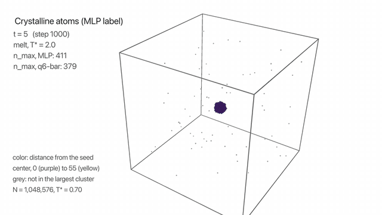

*1,048,576 atoms at T\* = 0.70. Only the atoms that the in situ neural network labels crystalline
are drawn, colored by distance from the seed (grey: crystalline atoms outside the largest cluster).
Movies: [crystal](docs/media/nucleation_crystal.mp4),
[slab through the seed with both label sets](docs/media/nucleation_slab.mp4).*

Manas Vardhan, CSCI 596 (Scientific Computing and Visualization), USC, Fall 2026. Solo project.

---

## Contents

1. [Abstract](#1-abstract)
2. [Background](#2-background)
3. [Method](#3-method)
4. [Validation](#4-validation)
5. [Results](#5-results)
6. [Limitations](#6-limitations)
7. [Future work](#7-future-work)
8. [Reproduce](#8-reproduce)
9. [Repository layout](#9-repository-layout)
10. [Author and acknowledgments](#10-author-and-acknowledgments)
11. [References](#11-references)

Detailed appendices: [design](docs/design.md), [plan](docs/plan.md), [abstract](docs/abstract.md),
[validation](docs/validation.md), [classifier](docs/classifier.md), [in situ pipeline](docs/insitu.md),
[all measurements](docs/results.md).

---

## 1. Abstract

**Problem.** Crystallization of a supercooled liquid starts with a rare, short-lived event: a
nanometer-sized crystal nucleus appears somewhere in a large volume of disordered atoms and either
dissolves or grows. Molecular dynamics (MD) resolves this atom by atom, but nobody knows in advance
where or when it will happen, so the usual workflow writes the full trajectory to disk at high
frequency and searches it afterwards. At scale this makes I/O, not computation, the bottleneck, and
almost all of the stored data describes nothing of interest.

**Finding.** I built a GPU-accelerated spatial-decomposition MD code (C, MPI, CUDA) on the course
code `pmd.c` and split its MPI ranks into simulation (SIM) ranks and dedicated in situ analysis (ANA)
ranks. Every K = 100 steps the ANA ranks compute Steinhardt bond-order features for every atom, label
it with a small neural network trained on data from the same code, find the largest crystalline
cluster, and write only labels and a summary. In a 1,048,576-atom seeded run on 2 P100 GPUs, the
analysis tracked the nucleus from about 600 atoms to 428,505 atoms (41% of the box) over 97,400 steps
and wrote **46x fewer bytes** than a full dump at the same frequency (13x with the movie frames). In a
separate check the in situ labels agree exactly with a post hoc analysis of a full dump (0 mismatches
in 7.1 million atom labels). With 4 ANA ranks the analysis never stalls the simulation: it adds
**+5.2 ± 1.1%** (about 1 ms) to the step time when it shares the GPU node, and **+0.2 ± 0.3%** (within
noise) when it runs on a separate node (the separate-node test used the original kernel). One P100 is **33 to 43x** faster than one CPU core but only
**2.4 to 3.4x** faster than the full 20-core node. Whether the analysis keeps up is decided by the
number of analysis ranks relative to the MD time between analysis steps, not by the neural network,
which is about 3% of the per-atom analysis cost (0.06 of 1.9 µs per atom on one core).

**So what.** Simulate on GPUs, understand the result in flight, and store only what matters: the
SIM/ANA communicator split costs a few percent of the step and removes most of the output, and it
carries over to any large simulation whose interesting events are rare and whose raw output is too
large to keep. The measurements also show where the cost really is: with the forces on the GPU, the
host-side work and the node's shared cores, not the GPU or the analysis protocol, limit the step.

---

## 2. Background

### 2.1 Crystal nucleation and why it is hard to catch

MD has been used to study phase transitions since its beginning: Alder and Wainwright's hard-sphere
simulations [1] showed a fluid-solid transition, and Rahman's argon simulations [2] introduced the
Lennard-Jones (LJ) liquid that is still the standard test system. In classical nucleation theory [4] a
supercooled liquid must form a crystalline nucleus larger than a critical size before the crystal can
grow; below that size the surface free energy wins and the nucleus dissolves. Reaching the critical
size is a rare fluctuation, so at moderate undercooling a simulation can run for a long time with
nothing happening, and then nucleation occurs in a short window at an unknown place [3, 4]. Biased
sampling methods, such as umbrella sampling on the size of the largest crystalline cluster [3, 5],
were developed to deal with exactly this rarity [4]. The quantity that all of them track is the one this
project computes on the fly: n_max(t), the number of atoms in the largest crystalline cluster.

### 2.2 The I/O wall and in situ analysis

The usual workflow (simulate, write snapshots, analyze afterwards) assumes that storage and I/O
bandwidth keep up with computation. On large machines they do not: compute has grown much faster
than file-system bandwidth, so writing everything is often impossible, and in situ processing,
where the analysis runs while the data is still in memory, has become a standard approach [6, 7].
Approaches range from analysis inside the simulation process (in line) to dedicated analysis
resources on the same or other nodes that receive data asynchronously (in transit) [6, 7]. This
project uses the second form inside one MPI job: a fixed group of ranks receives positions with
nonblocking messages, so the simulation keeps stepping while the analysis runs.

### 2.3 Steinhardt bond-order parameters

To call an atom "crystalline" one needs a local, rotation-invariant measure of order. Steinhardt,
Nelson and Ronchetti [8] defined, for each atom i with N_b neighbors,
q_lm(i) = (1/N_b) Σ_j Y_lm(r̂_ij) and q_l(i) = sqrt(4π/(2l+1) Σ_m |q_lm(i)|²), which are large and
characteristic for ordered environments (FCC: q4 = 0.191, q6 = 0.575) and small for a liquid. ten
Wolde, Ruiz-Montero and Frenkel [3] used normalized q6 vectors to define solid-like atoms and clusters
in LJ nucleation. Lechner and Dellago [9] showed that averaging q_lm over an atom and its neighbors
(q̄_l) separates the phases much more sharply, at the cost of a second neighbor shell. This project
uses [q̄4, q̄6, q4, q6, coordination] as the per-atom feature vector, which is why the analysis needs a
halo of two neighbor shells (section 3.3).

### 2.4 Machine-learning classifiers for local structure

A single threshold on q̄6 works well for bulk FCC versus liquid, but the boundary becomes ambiguous
at interfaces and with several crystal structures. Neural networks on symmetry-function descriptors of the
neighborhood were proposed for this by Geiger and Dellago [10], and later work learned the structure directly from
neighbor coordinates [11]. Here the classifier is deliberately small (402 parameters) so that it can
run in plain C inside the MPI job, and it is always compared with the q̄6 threshold baseline.

---

## 3. Method

### 3.1 Physical model and protocol

LJ atoms in reduced units (σ = ε = m = 1), force-shifted at r_c = 2.5, velocity Verlet, periodic
boundaries, linked-list cells, and a Berendsen velocity-rescaling thermostat [12] applied globally
with `MPI_Allreduce`. The liquid is melted, quenched below the freezing point and held; a small
spherical FCC seed is frozen in the middle until shortly after the quench and then released. The
quench point and seed were chosen with smoke tests ([validation.md, T1.4](docs/validation.md#t14-quench-point-and-seed-size)):
at T_q = 0.70 an unseeded liquid stays liquid for 80k hold steps (largest solid cluster at most 12
atoms), seeds of 55 and 87 atoms melt, and seeds of 249 and 369 atoms grow. At T_q = 0.55 the
liquid nucleates on its own and would compete with the seed.

| Parameter | Production value |
|---|---|
| Atoms N | 1,048,576 (4 x 64³ FCC cells) |
| Density ρ\* | 0.95 (box L = 103.4 σ) |
| Potential | LJ, force-shifted, r_c = 2.5 |
| Time step Δt | 0.005 |
| Thermostat | Berendsen, τ_T = 0.1 |
| Melt | T\* = 2.0 for 5000 steps |
| Quench | linear ramp to T_q = 0.70 over 2000 steps |
| Hold | T\* = 0.70, 105,000 steps planned (90,400 reached) |
| Seed | sphere of radius 4.5 σ (369 atoms) at the box center, frozen until step 8000 |
| Analysis | every K = 100 steps, r_q = 1.5, movie frame every 1000 steps |
| Layout | 4 SIM ranks (vproc 2 2 1) on 2 P100 GPUs, 4 ANA ranks with 2 OpenMP threads each |

Inputs: [`runs/production/prod_p100.in`](runs/production/prod_p100.in) (the run reported here) and
[`runs/production/prod.in`](runs/production/prod.in) (the planned 4-A100 run).

### 3.2 Parallel architecture

```
MPI_COMM_WORLD (P_sim + P_ana ranks)
  └─ MPI_Comm_split(color = rank < P_sim ? SIM : ANA)

SIM communicator: P_sim ranks, 1 GPU each       (spatial decomposition, course pmd.c)
  every step
    halo exchange of width r_c with 6 neighbors, atom migration           (host, MPI)
    LJ forces: copy coordinates to GPU, cell sort, kernel, copy back      (CUDA)
    velocity Verlet, thermostat                                           (host)
  every K steps
    second halo exchange of width 2 r_q = 3.0                             (host, MPI)
    MPI_Wait on the previous send (timed as the stall)
    pack residents + halo + global IDs, MPI_Isend, keep stepping
                    │
                    │  one message per SIM rank per analysis step
                    ▼  (SIM rank s -> ANA rank s * P_ana / P_sim)
ANA communicator: P_ana ranks, CPU + OpenMP
  every K steps, for each assigned SIM rank
    MPI_Probe + MPI_Recv the block
    q4, q6, q̄4, q̄6, coordination (steinhardt.c)
    labels: MLP 5-16-16-2 (mlp.c) and the baseline q̄6 > 0.308
  MPI_Gatherv of crystalline atoms to ANA root
  root: periodic cluster search (union-find), n_max, summary row,
        label file, movie frame every 10 analysis steps

Output: <prefix>_summary.dat, <prefix>_labels.bin, <prefix>_movie_<step>.bin (no trajectory)
```

The SIM side is the course code `pmd.c` (spatial decomposition, atom caching from 6 neighbors, atom
migration [13]) with three additions: a thermostat and melt/quench/seed protocol driven by a keyword
input file, a CUDA force path, and the in situ send. Each SIM rank binds to a GPU by its index within
the node on the SIM communicator, so ANA ranks never touch a GPU. Both sides compute the same list of
analysis steps from the input, each SIM rank has at most one message in flight, and the run ends
without an extra handshake. Details: [docs/insitu.md](docs/insitu.md).

### 3.3 The SIM/ANA split and the 2 r_q analysis halo

An ANA rank must compute q̄_l exactly for every atom its SIM ranks own, including atoms on the
subdomain boundary. q̄_l(i) averages q_lm over i and its neighbors within r_q = 1.5, and each
neighbor's q_lm needs *that* neighbor's full shell. So the ANA rank needs every atom within
**2 r_q = 3.0** of its subdomain, which is thicker than the force cache (r_c = 2.5). The SIM side
therefore runs a second halo exchange of width 2 r_q every K steps (`halo_copy`, the course
`atom_copy` with the width and target arrays as parameters), into separate arrays so the force cache
is untouched. A unit test shows why it matters: with a halo of only r_q, q6 is still exact but q̄6 is
wrong by up to 1.7e-2 at the edges ([classifier.md](docs/classifier.md#unit-tests-cd-tests--make-test)).
The message is one `MPI_DOUBLE` block (header, local positions of residents then halo atoms, global
IDs), sent with `MPI_Isend`; the SIM rank waits on it only before the next send, K steps later, and
that wait is timed as the stall.

### 3.4 CUDA force path and the cell-order fix

The force computation moves to the GPU and everything else stays on the host, so the MPI logic is
identical to the CPU code and the two paths can be compared directly. Every step, each SIM rank
copies resident plus cached coordinates to the device, bins them into the same (lc+2)³ cell grid as
the CPU path, sorts atoms by cell with CUB radix sort, computes LJ forces and per-atom energy in
double precision with one thread per resident atom over all neighbor cells (no Newton's third law, so
no atomics), and copies forces back. Device buffers persist and only grow. The GPU and CPU forces
agree to 8.0e-14 relative error ([validation](#4-validation)).

**The cell-order fix.** The first version launched one thread per atom in host array order. At the
start that order is the FCC lattice, so the 32 threads of a warp handle neighboring atoms and read
the same few cells. As the liquid diffuses during the melt, the host order stops matching space and
each thread of a warp walks different cells: poor cache reuse and divergent loop lengths. The force
call slowed from 10.3 to 19.4 ms per rank over the first ~7000 steps and then stayed there. The fix
(commit [`9d1a074`](https://github.com/ManasVardhan/insitu-nucleation-md/commit/9d1a074)) lets thread
s handle atom `vals[s]` of the cell sort the kernel already does, so a warp always covers one region
of space. Each atom still sums over the same cells in the same order, so the forces are bit-identical
(energies agree to all printed digits over 3000 steps, job 14363770). On the production protocol the
hold-phase step time drops from **31.8 to 18.7 ms (1.7x)** and no longer drifts
([results.md, section 8](docs/results.md#8-step-time-drift-and-the-force-kernel-fix)).

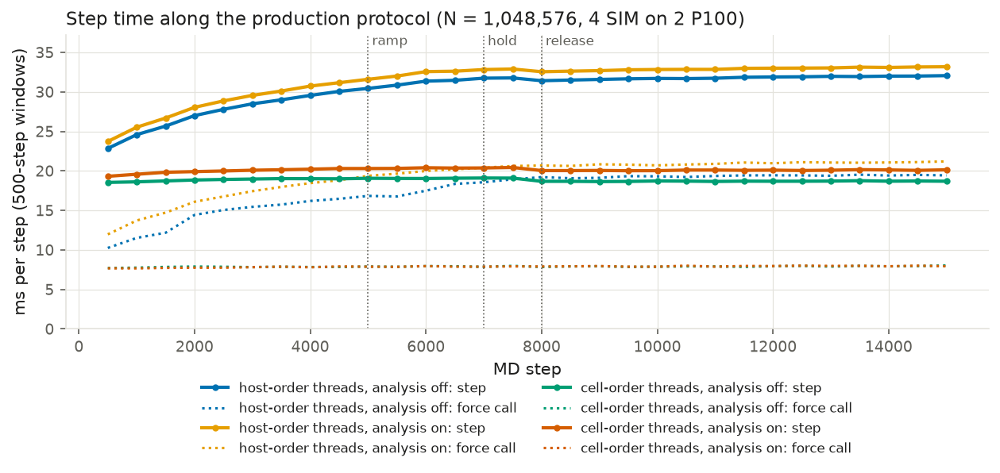

### 3.5 Classifier and training data

Training data comes from the project's own serial LJ generator ([`train/gen_data.c`](train/gen_data.c)):
thermalized FCC crystals (label 1) and melted-and-quenched liquids (label 0) at 12 training state
points, T ∈ {0.45, 0.55, 0.65, 0.75} x ρ ∈ {0.90, 0.95, 1.00} (279,936 atoms). The test set uses
6 state points *between* the training grid values, T ∈ {0.50, 0.60, 0.70} x ρ ∈ {0.925, 0.975}
(139,968 atoms), so no test state point is seen in training. Crystal/liquid slabs (49,152 atoms) are
used only for evaluation at an interface. Features come from the same `steinhardt.c` that runs in
situ. The model is an MLP 5 → 16 → 16 → 2 with ReLU (402 parameters), trained in PyTorch in about
5 s and exported to a C header; inference is a hand-written C forward pass that matches PyTorch to
1.8e-15 with 0 label mismatches on 2000 samples. The baseline is a single threshold q̄6 > 0.308 fitted
on the training set. Details: [docs/classifier.md](docs/classifier.md).

| Accuracy | MLP | q̄6 threshold |
|---|---|---|
| Held-out bulk state points | **99.94%** | 99.88% |
| Slab, all atoms (current-interface truth) | 95.4% | 95.7% |
| Slab, within 1 σ of the interface | 73.7% | **75.0%** |

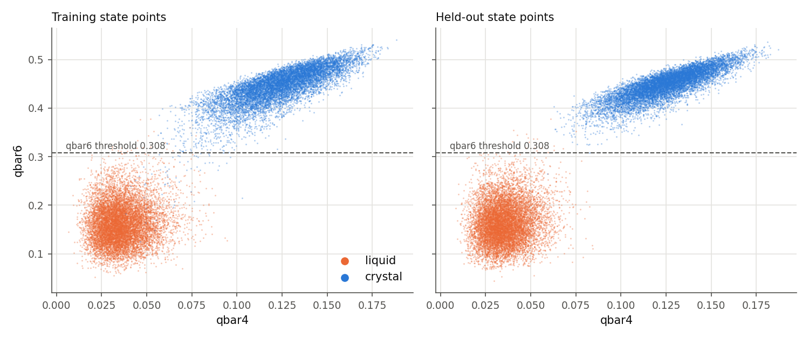

In bulk the MLP makes half as many errors as the threshold; at an interface it does not beat it.

---

## 4. Validation

All on CARC Discovery, debug node e23-02 (2x P100). Details: [docs/validation.md](docs/validation.md),
[docs/insitu.md](docs/insitu.md#t25-equivalence-check-in-situ-vs-post-hoc), [docs/classifier.md](docs/classifier.md).

| Check | Criterion | Result | Pass |
|---|---|---|---|
| Course code with global IDs and keyword input vs original `pmd.c` | identical trajectories | same energies to all printed digits (2 ranks, 400 steps); every global ID owned by exactly one rank (`-DCHECK_IDS`) | yes |
| GPU vs CPU forces | max relative error < 1e-10 | 8.0e-14 max per-atom \|ΔF\|/\|F\| (2 and 4 ranks) | yes |
| NVE energy drift, thermostat off, 10k steps | < 1e-4 per atom | GPU 1.8e-5, CPU 1.7e-5 (end - start) | yes |
| Liquid g(r), T\* = 0.722, ρ\* = 0.8442 | peaks match the standard LJ liquid [14, 15] | 1st peak 1.085 (g = 3.04), 1st minimum 1.535, 2nd peak 2.045 | yes |
| Thermostat | settles within 1% of target | mean T 0.72198 vs 0.722; within 1% after ~140 steps | yes |
| Steinhardt features | perfect FCC values, invariances | q4 = 0.19094065, q6 = 0.57452426; rotation/translation/reordering ≤ 4.0e-15; matches an O(N²) reference to 6.1e-16 | yes |
| Classifier | > 95% held-out accuracy | 99.94% (q̄6 threshold 99.88%) | yes |
| C MLP vs PyTorch | identical labels | max logit difference 1.8e-15, 0 mismatches in 2000 | yes |
| In situ vs post hoc (T2.5) | identical labels from a full dump of the same run | 0 mismatches in 3,552,000 atom labels for each of 2 SIM + 1 ANA and 4 SIM + 2 ANA, for both label sets, cluster membership and n_max at all 111 steps | yes |
| Analysis does not perturb the trajectory | identical energies | `pmd_insitu_cpu` matches `pmd` to all printed digits over 5000 steps | yes |
| Cell-order kernel vs original kernel | identical forces | energies agree to all printed digits over 3000 steps | yes |

---

## 5. Results

All measurements ran on CARC Discovery with the code in this repository. Every GPU number comes from
one node, the debug node **e23-02** (2x Tesla P100-PCIE-16GB, 2x Xeon E5-2640 v4 with 10 cores each),
because it was the only GPU node that could be scheduled (see [Limitations](#6-limitations)). Times
are wall-clock ms per MD step; ± is the sample standard deviation over repeated runs (3 unless
noted). Raw CSVs, summaries and Slurm logs are in [`runs/perf/results/`](runs/perf/results/); the full
tables and more discussion are in [docs/results.md](docs/results.md).

### 5.1 Science: the nucleus grows, and nothing else nucleates

The production run (job 14361069, inputs in section 3.1, summary in
[`runs/production/results/p100/`](runs/production/results/p100/)) ran before the kernel fix, at 36.4 ms
per step on average, and was stopped by the 1 h debug limit at step 97,400. The fix changes only the
speed, not the trajectory (bit-identical forces). Analysis ran at all 974 analysis steps.

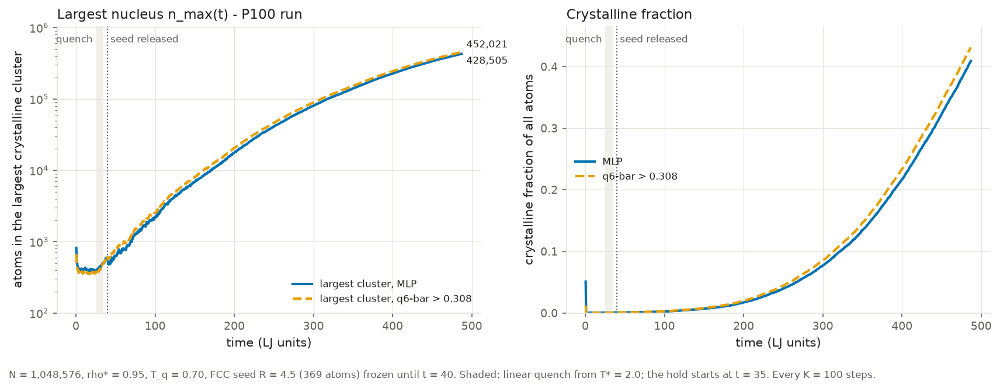

| t (LJ time) | n_max, MLP | n_max, q̄6 > 0.308 | crystalline fraction, MLP |
|---|---|---|---|
| 40 (seed release) | 594 | 606 | 0.09% |
| 100 | 2,157 | 2,529 | 0.25% |
| 200 | 17,642 | 20,522 | 1.7% |
| 300 | 80,322 | 88,787 | 7.7% |
| 400 | 227,444 | 244,689 | 21.7% |
| 487 (last) | 428,505 | 452,021 | 40.9% |

The released seed grows steadily and is still growing when the run ends. After t of about 200 the
cube root of n_max (a radius) grows almost linearly, so the interface moves at a roughly constant
speed and n_max grows like t³, not exponentially. No
other nucleus forms: the second-largest cluster never exceeds 34 atoms (MLP). The q̄6 threshold always
finds a larger cluster (5 to 23% larger from t = 100 on, up to 30% just after the seed release), and the slab movie shows where the surplus sits: on the crystal
surface and at internal defects between lobes, which matches the interface bias measured in the
classifier evaluation.

| t = 150 | t = 300 | t = 485 |
|---|---|---|
| 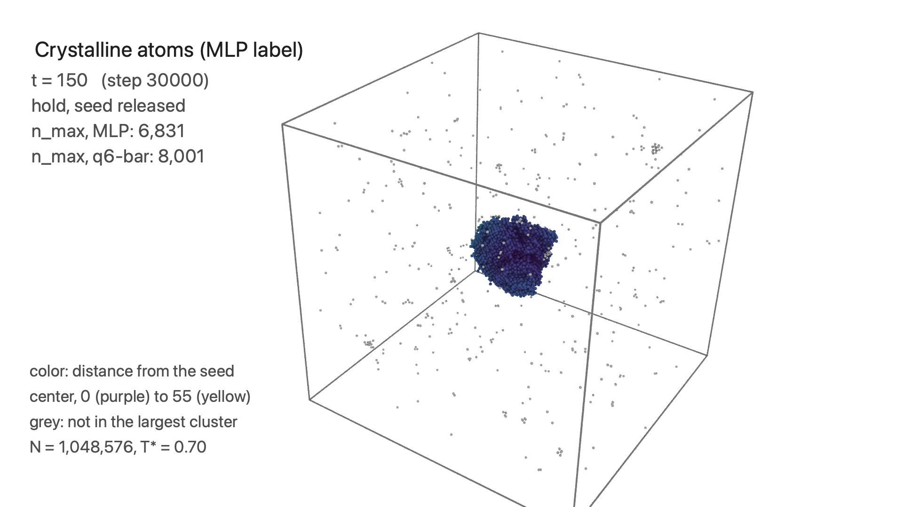 | 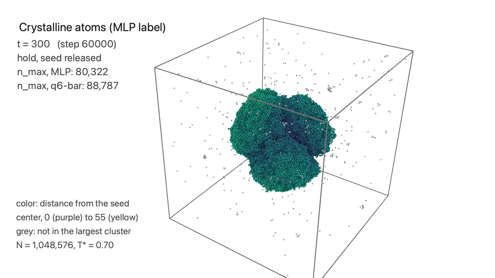 | 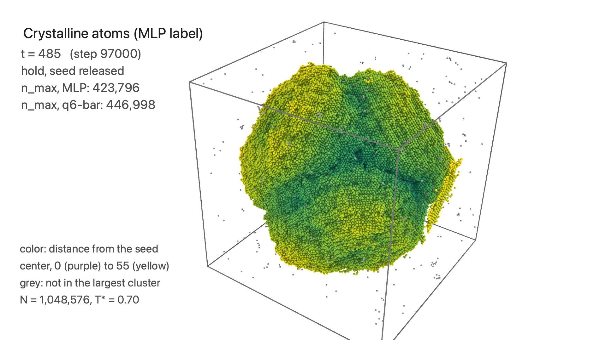 |

### 5.2 GPU speedup

`scripts/perf_speedup.slurm`, job 14364484 (cell-order kernel). The same global box for every layout
(ρ\* = 0.95, NVE from the FCC lattice; it stays a hot solid at T of about 1), CPU path with 1 rank
per core, GPU path with 1 rank per P100.

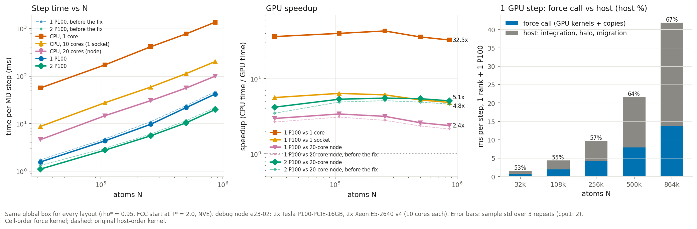

| N | CPU, 1 core | CPU, 20 cores (node) | 1 P100 | 2 P100 | 1 P100 vs 1 core | 1 P100 vs node | 2 P100 vs node |
|---|---|---|---|---|---|---|---|
| 32,000 | 56.32 | 4.61 | 1.56 | 1.11 | 36.0x | 2.9x | 4.2x |
| 108,000 | 171.98 | 14.65 | 4.33 | 2.76 | 39.7x | 3.4x | 5.3x |
| 256,000 | 413.85 | 30.43 | 9.67 | 5.54 | 42.8x | 3.1x | 5.5x |
| 500,000 | 772.32 | 56.09 | 21.68 | 10.39 | 35.6x | 2.6x | 5.4x |
| 864,000 | 1358.82 | 99.41 | 41.86 | 19.67 | 32.5x | 2.4x | 5.1x |

One P100 is 33 to 43x faster than one core, but the fair comparison is against the whole node: one
P100 beats all 20 cores by only 2.4 to 3.4x, and both P100s by 4.2 to 5.5x. The reason is in the right
panel: the force call (kernels plus copies) is now 16 to 23 ns per atom, and the host work around it
(integration, halo packing, migration, on one core per rank) is 53 to 67% of the 1-GPU step and grows
faster than the force part, so the GPU advantage shrinks at large N. In a melting liquid the old
kernel lost a third of its speed and the new one does not: at N = 256,000 one P100 is 3.0x the node
with the fix and 2.0x without ([results.md, section 8](docs/results.md#cpu-vs-gpu-in-a-solid-and-in-a-liquid)).

*Before the fix* (job 14362860, original host-order kernel): 29 to 38x one core, 2.1 to 3.1x the node
with one P100, 3.5 to 5.1x with two.

### 5.3 Strong and weak scaling

`scripts/perf_scaling.slurm`, job 14364485 (cell-order kernel). Strong scaling at fixed N, weak
scaling at fixed atoms per rank, on the one GPU node: GPU path on 1 and 2 P100s, CPU path on 1 to 20
cores.

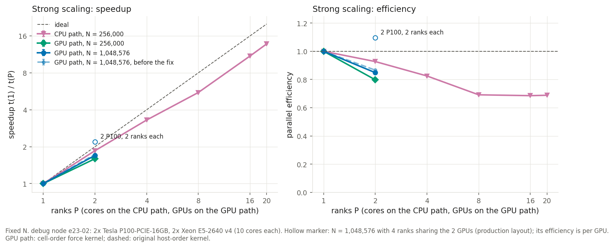

| Strong scaling | P = 1 | P = 2 | speedup | efficiency |
|---|---|---|---|---|
| GPU, N = 1,048,576 | 51.73 ms | 30.50 ms | 1.70x | 0.85 |
| GPU, N = 1,048,576, 4 ranks sharing the 2 P100 (production layout) | 51.73 ms | 23.58 ms | 2.19x | 1.10 per GPU |
| GPU, N = 256,000 | 9.69 ms | 6.08 ms | 1.60x | 0.80 |
| CPU, N = 256,000, 1 to 20 cores | 416.86 ms | 30.29 ms (P = 20) | 13.8x | 0.69 |

Going from 1 to 2 P100s halves the force call (16.3 to 8.7 ms at 1M atoms) but not the host part
(33.4 to 19.5 ms) or the halo exchange, so the efficiency is 0.85. Putting two ranks on each GPU is
faster still (2.19x), because it spreads the host work over 4 cores: the host, not the GPU, limits
the step. The CPU path loses efficiency between 4 and 8 cores and then stays flat at 0.69 to 20
cores, while MPI communication stays below 1 ms per step; this points to per-core slowdown when a
socket is busy (clock and shared cache or memory bandwidth), which is inferred, not measured.

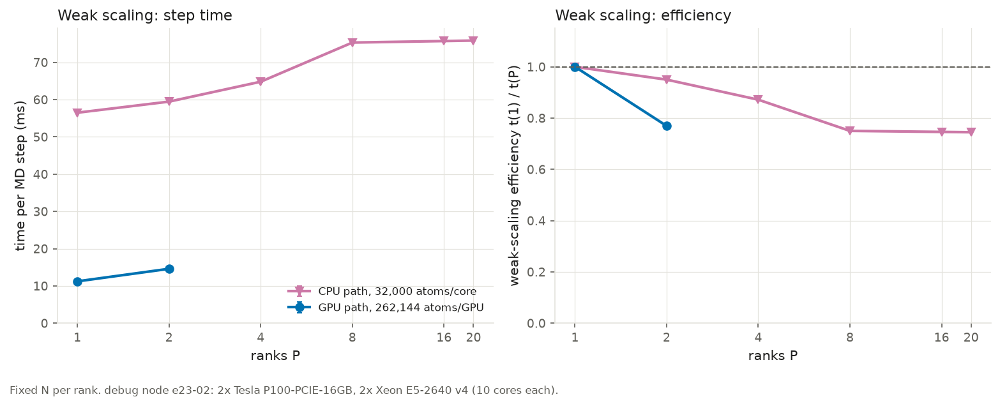

Weak scaling: 0.73 on 2 P100s at 262,144 atoms per GPU (9.96 to 13.61 ms; the force call is
unchanged at 4.2 ms, the host part and halo exchange grow), and 0.75 on 20 cores at 32,000 atoms per
core, flat from 8 cores on.

*Before the fix* (job 14362861): 58.52 and 33.78 ms at 1M atoms (1.73x, efficiency 0.87), 25.97 ms
with 4 ranks (2.25x), weak-scaling efficiency 0.77. The fix makes every GPU step 7 to 12% faster but
the relative scaling slightly worse, because only the force call got faster and the host share,
which scales worse, grew.

### 5.4 In situ overhead

`scripts/perf_insitu.slurm` and `scripts/perf_insitu_sep.slurm`. The production layout (N = 1,048,576,
4 SIM ranks on the 2 P100s, every rank on 2 cores, 2 OpenMP threads per ANA rank), the seeded protocol
shortened to 3000 steps, analysis on and off interleaved in the same job, 3 repeats each. The
overhead is the SIM step time against the analysis-off runs of the same job.

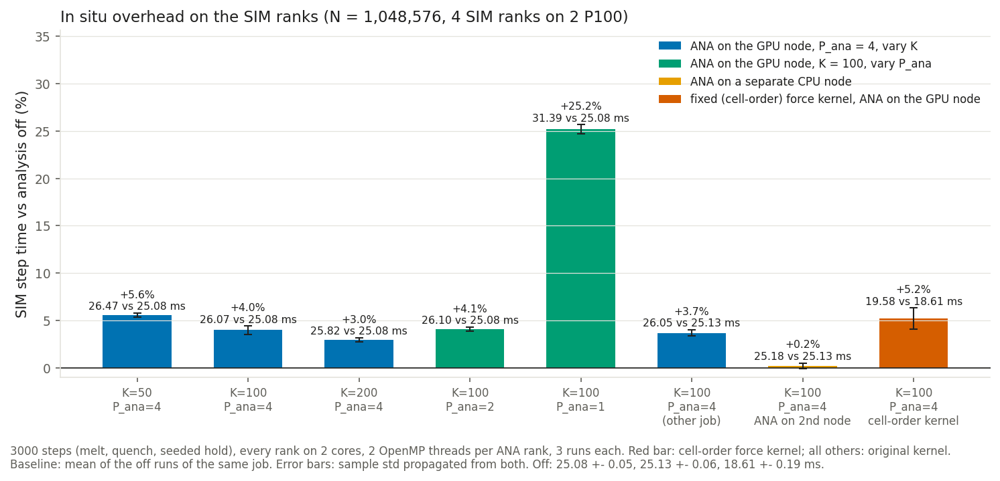

| Configuration | Kernel | SIM ms/step, off → on | Overhead | t_analysis vs K x step time | SIM stall |
|---|---|---|---|---|---|
| K = 100, P_ana = 4, ANA on the GPU node | cell-order (job 14364486) | 18.61 → 19.58 | **+5.2 ± 1.1%** | 0.84 s vs 1.96 s | 0 |
| K = 100, P_ana = 4, ANA on the GPU node | original (job 14363611) | 25.08 → 26.07 | +4.0 ± 0.4% | 0.83 s vs 2.67 s | 0 |
| K = 50 / 200, P_ana = 4, ANA on the GPU node | original | 25.08 → 26.47 / 25.82 | +5.6 / +3.0% | 0.83 s vs 1.36 / 5.29 s | 0 |
| K = 100, P_ana = 4, **ANA on a separate CPU node** | original (job 14362880) | 25.13 → 25.18 | **+0.2 ± 0.3%** | 1.00 s vs 2.58 s | 0 |
| K = 100, P_ana = 2, ANA on the GPU node | original | 25.08 → 26.10 | +4.1% | 1.56 s vs 2.65 s | 0 |
| K = 100, **P_ana = 1**, ANA on the GPU node | original | 25.08 → 31.39 | **+25.2%** | 3.08 s vs 3.13 s | 13.6 s |

- **On the same node the analysis costs about 1 ms per step, and that cost comes from sharing the
  node, not from the in situ protocol.** The work it adds on the SIM side (the 2 r_q halo exchange and
  packing) is 0.075 ms per step and the SIM ranks never wait for the ANA ranks. The rest is the ANA
  ranks competing with the SIM ranks' host work for the node's cores, caches and memory bandwidth:
  moving the same 4 ANA ranks to a separate node removes it (+0.2 ± 0.3%, within noise).
- **The fix did not change the cost, only its share.** The absolute overhead is 0.97 ms per step with
  the cell-order kernel and 0.99 ms with the original one, so with the 26% shorter step it is +5.2%
  instead of +4.0%. The K, P_ana and separate-node runs were not repeated with the new kernel; since
  the cost is the same in milliseconds, their percentages would be about 1.35x larger.
- **P_ana decides whether the analysis keeps up.** t_analysis scales almost inversely with P_ana. With
  2 or 4 ANA ranks it fits in the MD time between analysis steps and the overhead is the same; with 1
  it does not, each SIM rank blocks on its previous send (13.6 s in total), and the step time grows
  25% until K x step time equals t_analysis. This is the design trade-off, measured: P_ana must be
  large enough that t_analysis < K x step time.

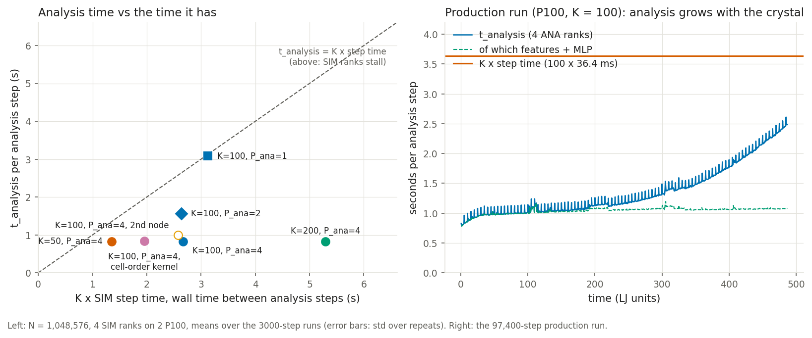

In the production run the margin shrinks as the crystal grows (right panel): features and MLP stay at
about 1.0 to 1.1 s per analysis step, but the cluster search and label output on ANA root grow with the
number of crystalline atoms, so t_analysis rises from 1.1 to 2.5 s against 3.6 s of MD. A longer run at this K and P_ana
would start to stall at a crystalline fraction of about 0.75; parallelizing the cluster search or
raising K would fix that. With the faster kernel the MD time per analysis step is shorter (1.96 s
in the 3000-step runs), so this limit would be reached earlier.

### 5.5 I/O savings

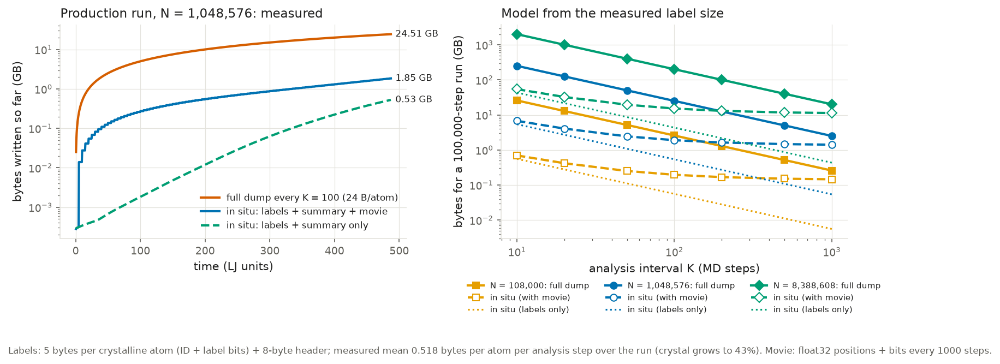

| Production run (N = 1,048,576, K = 100, 974 analysis steps) | Bytes | vs full dump |
|---|---|---|
| Full-precision dump of all atoms every K steps (24 B/atom) | 24.51 GB | 1x |
| In situ: labels + summary + 97 movie frames | 1.85 GB | 13.2x smaller |
| In situ: labels + summary only | 0.53 GB | 46.4x smaller |

The labels cost 0.52 bytes per atom per analysis step on average (5 bytes per crystalline atom),
against 24 for the dump. Both costs are linear in N, so the ratio does not depend on N; it depends
on the crystalline fraction (a box that is entirely crystal would still be 5x smaller) and on K
(the movie is written every 1000 steps regardless of K). These are bytes, not seconds: at this N a
dump step is 25 MB, which a parallel file system writes in well under a second, so the saving
matters for storage (24.5 GB for this one run) and grows with N and with more frequent analysis.

---

## 6. Limitations

- **GPU scaling stops at 2 P100s.** The plan was V100 and A100 nodes in the `gpu` partition, but none
  could be scheduled during the project window; every GPU result comes from the one debug node with
  2 P100s. A multi-node strong and weak scaling job (1 to 8 V100 over 4 nodes, job 14362902) and the
  full 4-A100 production run (job 14357822) were still pending in the queue (reason: Priority) when
  this report was written, so there are no multi-node or A100 numbers.
- **The production run used the original force kernel and was cut short.** It ran before the
  cell-order fix at 36.4 ms per step on average (a 15,000-step reproduction of the same protocol
  with analysis on runs at 32.9 ms per step in the hold with the original kernel and 20.1 ms with
  the fix) and was stopped by the 1 h debug limit at step 97,400 of 112,000 (hold step 90,400 of 105,000). The
  physics is unaffected: the fix gives bit-identical forces, and all 974 analysis steps up to the cut
  are complete.
- **The classifier does not beat the baseline where it matters most.** At a crystal/liquid
  interface the MLP ties or slightly trails the q̄6 threshold (73.7% vs 75.0% within 1 σ), and both put the interface
  about 0.5 to 1 σ into the liquid, which inflates n_max by about one surface shell. Training on
  interfaces helped the MLP (+4 points) but moving the threshold to 0.345 helped more: with these five
  features, nearly all the information is in q̄6.
- **The GPU path is host-bound.** Only the forces run on the GPU. Integration, halo packing and
  migration run on one core per rank and are 53 to 67% of the 1-GPU step, so the GPU is idle much of
  the time and one P100 beats the whole 20-core node by only 2.4 to 3.4x.
- **Seeded, not homogeneous, nucleation.** The seed makes growth reliable within the compute budget,
  but the run does not measure a nucleation rate.
- **Some causes are inferred, not measured:** the per-core slowdown of the CPU path when 8 or more
  cores of a socket are busy (likely lower turbo clock and shared L3 and memory bandwidth), the
  constant ~0.5 ms in situ cost at any K (consistent with idle ANA ranks busy-polling in
  `MPI_Probe`), and the gap of about 4 ms between the production run (36.4 ms per step averaged over the whole run, 59:09 for 97,400 steps including startup; per-step timing
  was not logged) and a 15,000-step reproduction (32 to 33 ms).
- **I/O is reported in bytes**, not seconds; the code does not time file writes separately.

---

## 7. Future work

- **Device-resident positions with halo-only transfers.** Keep positions, velocities and the
  integrator on the GPU and copy only the halo and migrating atoms, which removes the host work that
  now limits the step.
- **Unseeded homogeneous nucleation.** At T_q = 0.55 the 108k-atom liquid nucleates on its own within
  15k to 25k hold steps, which is in reach at 1M atoms and would give a rate and the location of
  spontaneous nuclei, where in situ detection matters most.
- **An interface-aware classifier.** Train on interfacial atoms with a better ground truth, or add
  features that see beyond the q̄ shell, and parallelize the cluster search, which now runs on ANA
  root and grows with the crystal.
- **Multi-node A100 runs.** Run the pending 4-A100 production and the 1 to 8 GPU scaling jobs with
  the fixed kernel, with ANA ranks on their own nodes.

---

## 8. Reproduce

Everything runs on CARC Discovery (account `anakano_429`). Use login shells (`bash -l`), since the job
scripts call `module`.

**Build.**

```bash
git clone https://github.com/ManasVardhan/insitu-nucleation-md.git
cd insitu-nucleation-md
module load gcc/13.3.0 openmpi/5.0.5 cuda/12.6.3
make -C src            # pmd (CPU), pmd_cuda (-DUSE_CUDA), pmd_insitu (CUDA + -DINSITU), posthoc
```

A single run is `srun -n <P_sim + P_ana> src/pmd_insitu <input>` with a keyword input file
(see [`src/pmd.in`](src/pmd.in) and the keyword table in [docs/insitu.md](docs/insitu.md)).

**Tests** (no MPI or GPU needed, any machine with a C compiler):

```bash
cd tests && make test          # Steinhardt features, C MLP vs PyTorch, cluster search
```

**Validation and the in situ vs post hoc check.**

```bash
salloc -p debug -A anakano_429 -N 1 -n 4 --gres=gpu:2 -t 00:40:00 bash scripts/run_validation.sh
sbatch scripts/insitu_check.slurm          # T2.5: in situ vs post hoc, runs/insitu_check/
python analysis/energy_check.py runs/validation/out/nve_gpu.log runs/validation/out/nve_cpu.log
python analysis/gr.py runs/validation/out/nve_0000{5000,5500,6000,6500,7000}.xyz
```

**Production run.**

```bash
sbatch scripts/production.slurm                                   # 4 A100 over 2 nodes, prod.in
# the P100 run reported here (job 14361069: 1 debug node, 8 tasks x 2 cores, 2 P100):
sbatch -p debug -N 1 --ntasks-per-node=8 -c 2 --gres=gpu:p100:2 \
  scripts/production.slurm runs/production/prod_p100.in:runs/production/out_p100
```

**Performance measurements** (each job takes 10 to 30 min on the debug node and writes
`runs/perf/results/<exp>_<jobid>.csv`):

```bash
sbatch scripts/perf_speedup.slurm                     # CPU vs GPU vs N
sbatch scripts/perf_scaling.slurm                     # strong and weak scaling, 1 node
sbatch scripts/perf_insitu.slurm off:0:0 k100:100:4 k50:50:4 k200:200:4   # tag:K:P_ana
sbatch scripts/perf_insitu_sep.slurm                  # ANA on the GPU node vs a separate node
sbatch scripts/perf_drift.slurm                       # step time along the production protocol
OLD=<dir with a pre-9d1a074 src/pmd_cuda> sbatch scripts/perf_sortfix.slurm   # old vs new kernel
OLD=<same> sbatch scripts/perf_mixed.slurm            # solid vs liquid (MELT=1), both kernels
sbatch scripts/perf_scaling_multi.slurm               # 1 to 8 V100 over 4 nodes (gpu partition)
```

`SMOKE=1 sbatch ...` runs a tiny version of the `perf_*` jobs first. The results reported here
are in `runs/perf/results/`; files with `_cellorder` in the name were measured after the kernel fix.

**Training data and classifier** (locally; Python with PyTorch, NumPy, pandas, matplotlib):

```bash
sh train/gen_all.sh                 # about 3 min on 8 cores -> train/data/ (gitignored)
python3 train/train.py              # train/model.pt, train/results.json, docs/img/{feature_space,interface_accuracy,slab_profile}.png
python3 train/export_weights.py     # src/mlp_weights.h, tests/data/mlp_ref.csv
```

**Figures.**

```bash
python analysis/plot_perf.py        # docs/img/perf_*.png from runs/perf/results/, prints the tables
python analysis/plot_io.py runs/production/results/p100/prod_summary.dat docs/img/io_bytes.png
python analysis/plot_science.py runs/production/results/p100/prod_summary.dat \
  runs/production/results/p100/prod_p100.in docs/img/nmax_p100.png "P100 run"
python analysis/plot_nmax.py runs/production/results/p100/prod_summary.dat \
  docs/img/nmax_production_p100.png 35 40
```

**Movie** (needs the 97 movie frames from the run, 1.32 GB on CARC, and the OVITO [16] 3.x Python module):

```bash
python viz/extract_frames.py runs/production/out_p100 frames_small    # crystalline atoms + slab
python viz/render_movie.py frames_small movie_out --renderer opengl    # PNG frames for views A and B
```

The frames are then encoded to MP4 and GIF (24 fps, each frame held 3 times; see
[docs/results.md, section 7](docs/results.md#7-movie-and-stills)).

---

## 9. Repository layout

```
src/        pmd.c, pmd.h          MD code (course pmd.c + thermostat, protocol, seed, CUDA path, in situ send)
            force_cuda.cu/.h      CUDA cell-list LJ forces (cell sort with CUB, cell-order threads)
            insitu.c/.h           SIM/ANA split, nonblocking transfer, ANA loop, output files
            steinhardt.c/.h       q4, q6, q̄4, q̄6, coordination (cell list, OpenMP)
            mlp.c/.h, mlp_weights.h   C forward pass of the exported MLP
            cluster.c/.h          periodic cluster search (union-find)
            posthoc.c             post hoc equivalence check
            Makefile
train/      gen_data.c, gen_all.sh   serial LJ generator for the training data
            train.py, export_weights.py, model.pt, results.json
tests/      unit tests: Steinhardt, MLP parity, clusters
scripts/    Slurm job scripts for CARC (validation, smoke, production, perf_*)
analysis/   readers for the in situ output and every plot in this report
viz/        frame extraction and OVITO rendering
runs/       inputs and results: validation, smoke, nucleation, insitu_check, production, perf
docs/       design, plan, abstract, validation, classifier, insitu, results; img/ and media/
```

---

## 10. Author and acknowledgments

**Manas Vardhan**, solo project for CSCI 596 Scientific Computing and Visualization, Fall 2026,
University of Southern California.

The simulation is built on the course MD code `pmd.c` and `pmd.h` by Prof. Aiichiro Nakano (spatial
decomposition, atom caching and migration), provided as course base code; the SIM/ANA communicator
split follows the pattern of the course's `pmd_split.c` (Assignment 4). Computation was done on the Discovery cluster
of the USC Center for Advanced Research Computing (CARC).

---

## 11. References

1. B. J. Alder and T. E. Wainwright, "Phase transition for a hard sphere system," *J. Chem. Phys.* **27**, 1208 (1957).
2. A. Rahman, "Correlations in the motion of atoms in liquid argon," *Phys. Rev.* **136**, A405 (1964).
3. P. R. ten Wolde, M. J. Ruiz-Montero, and D. Frenkel, "Numerical calculation of the rate of crystal nucleation in a Lennard-Jones system at moderate undercooling," *J. Chem. Phys.* **104**, 9932 (1996).
4. G. C. Sosso, J. Chen, S. J. Cox, M. Fitzner, P. Pedevilla, A. Zen, and A. Michaelides, "Crystal nucleation in liquids: open questions and future challenges in molecular dynamics simulations," *Chem. Rev.* **116**, 7078 (2016).
5. S. Auer and D. Frenkel, "Prediction of absolute crystal-nucleation rate in hard-sphere colloids," *Nature* **409**, 1020 (2001).
6. H. Childs et al., "A terminology for in situ visualization and analysis systems," *Int. J. High Perform. Comput. Appl.* **34**, 676 (2020).
7. J. C. Bennett et al., "Combining in-situ and in-transit processing to enable extreme-scale scientific analysis," in *Proc. SC12* (2012).
8. P. J. Steinhardt, D. R. Nelson, and M. Ronchetti, "Bond-orientational order in liquids and glasses," *Phys. Rev. B* **28**, 784 (1983).
9. W. Lechner and C. Dellago, "Accurate determination of crystal structures based on averaged local bond order parameters," *J. Chem. Phys.* **129**, 114707 (2008).
10. P. Geiger and C. Dellago, "Neural networks for local structure detection in polymorphic systems," *J. Chem. Phys.* **139**, 164105 (2013).
11. R. S. DeFever, C. Targonski, S. W. Hall, M. C. Smith, and S. Sarupria, "A generalized deep learning approach for local structure identification in molecular simulations," *Chem. Sci.* **10**, 7503 (2019).
12. H. J. C. Berendsen, J. P. M. Postma, W. F. van Gunsteren, A. DiNola, and J. R. Haak, "Molecular dynamics with coupling to an external bath," *J. Chem. Phys.* **81**, 3684 (1984).
13. S. Plimpton, "Fast parallel algorithms for short-range molecular dynamics," *J. Comput. Phys.* **117**, 1 (1995).
14. L. Verlet, "Computer 'experiments' on classical fluids. II. Equilibrium correlation functions," *Phys. Rev.* **165**, 201 (1968).
15. D. Frenkel and B. Smit, *Understanding Molecular Simulation*, 2nd ed. (Academic Press, 2002).
16. A. Stukowski, "Visualization and analysis of atomistic simulation data with OVITO, the Open Visualization Tool," *Modelling Simul. Mater. Sci. Eng.* **18**, 015012 (2010).
