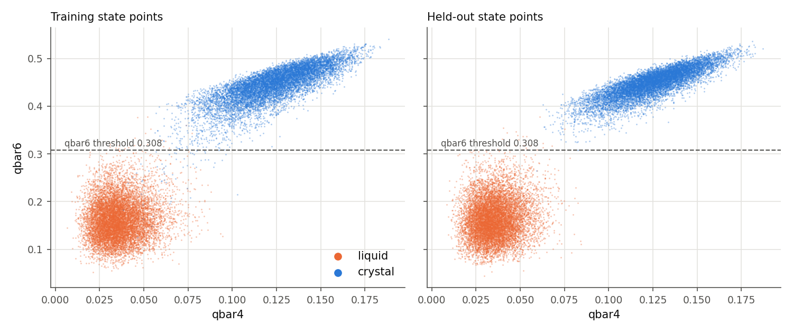
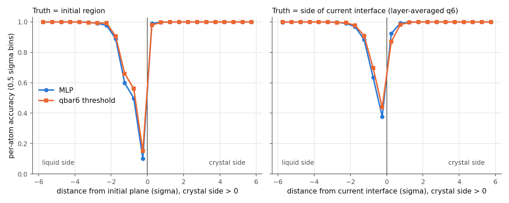
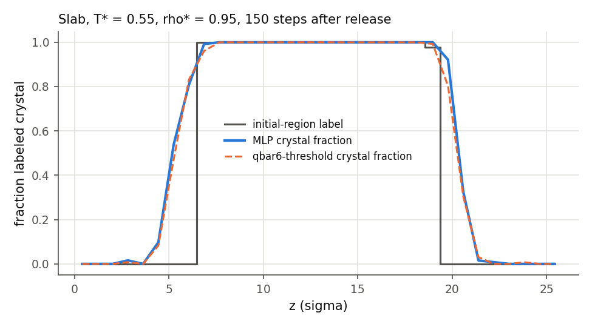

# Liquid / crystal classifier (T2.1 to T2.3)

This page covers the per-atom features, the training data, the MLP, the C inference code, and how
well it all works. Every number below comes from `train/results.json`, which `train/train.py` writes.

## 1. Features (`src/steinhardt.c`)

Neighbors of atom i are all atoms j with |r_ij| < r_q, where r_q = 1.5 by default (the first minimum
of the LJ liquid g(r)).

- q_lm(i) = (1/N_b(i)) Σ_j Y_lm(r̂_ij), and q_l(i) = sqrt(4π/(2l+1) Σ_m |q_lm(i)|²), for l = 4 and 6
- Lechner-Dellago average, including atom i itself: q̄_lm(i) = (1/(N_b(i)+1)) Σ_{k ∈ {i} ∪ nb(i)} q_lm(k),
  and q̄_l is built from q̄_lm the same way q_l is built from q_lm
- coordination = N_b(i)

The classifier input is `[qbar4, qbar6, q4, q6, coord]`. `steinhardt_features()` packs it in that order.

Y_lm is evaluated as K_lm · P̃_l^m(z/r) · ((x+iy)/r)^m, where P̃ is the polynomial part of the
associated Legendre function. This form has no singularity at the poles. Only m ≥ 0 is stored,
because the m < 0 terms follow from the symmetry Y_{l,-m} = (-1)^m Y*_lm.

### API

```c
int steinhardt_compute(int n_total, const double *pos, const int *is_resident, double r_q,
                       double *q4, double *q6, double *qbar4, double *qbar6, int *coord);
int steinhardt_periodic_images(int n, const double *pos, const double box[3], double halo,
                               double **pos_ext, int **is_res_ext, int **orig_ext);
int steinhardt_compute_periodic(int n, const double *pos, const double box[3], double r_q,
                                double *q4, double *q6, double *qbar4, double *qbar6, int *coord);
void steinhardt_features(double q4, double q6, double qbar4, double qbar6, int coord, double feat[5]);
```

- **Input.** `steinhardt_compute` takes local, non-periodic coordinates for residents plus halo atoms.
  Output arrays are indexed like `pos`. Residents get results and halo entries are set to 0.
  It uses an internal cell list, so the cost is O(n_total). It is reentrant.
- **Halo requirement.** The input must contain every atom within 2·r_q of any resident (a halo of
  thickness ≥ 2·r_q = 3.0). The q_lm of a resident's neighbor needs that neighbor's full shell. With a
  halo only r_q thick, q is still exact but q̄ is wrong at the edges (test [5] shows this).
- **Periodic systems.** Callers with periodic boundaries call `steinhardt_periodic_images` (halo
  2·r_q) and then the same `steinhardt_compute`. The training generator does this, so the training
  features and the in situ features come from identical code.

### Unit tests (`cd tests && make test`)

| Test | Result |
|---|---|
| Perfect FCC, open 8³-cell block, 256 interior residents | q4 = 0.19094065, q6 = 0.57452426, q̄4 = q4, q̄6 = q6, coordination 12 for all |
| Periodic FCC, 500 atoms, ρ = 0.90 / 0.95 / 1.00, image-halo path | every atom has the FCC values (max deviation from the 9-digit reference 9.6e-10), coordination 12 |
| 5 random rotations + translations of a perturbed FCC block | max feature difference 4.0e-15 |
| Pure translation / atom reordering | 2.4e-15 / 1.9e-16 |
| Cell list vs an independent O(N²) reference (Rodrigues Legendre, acos/atan2) | 6.1e-16 (thermal-like), 4.2e-16 (liquid-like) |
| One octant as residents, 2·r_q halo, compared with the full periodic box | 1.1e-16, coordination identical |
| Same with a 1·r_q halo (negative control) | q6 exact, q̄6 off by up to 1.7e-2, as expected |

Cost on this Mac (clang -O2, one core): 1.8 µs per atom for the features and 0.06 µs per atom for
the MLP (32,000 atoms, including the periodic image build).

## 2. Training data (`train/gen_data.c`, `train/gen_all.sh`)

The generator is a serial LJ MD code: r_c = 2.5 (truncated forces), velocity Verlet, Δt = 0.005, PBC,
linked-list cells, and velocity rescaling to the target T every step.

| Set | Protocol | Size |
|---|---|---|
| crystal (label 1) | FCC at ρ, Maxwell velocities at T, 2000 equilibration steps, then 4 snapshots 500 steps apart | 2916 atoms (9³ cells) |
| liquid (label 0) | FCC melted at T = 2.0 for 3000 steps, instant quench to T, 2000 equilibration steps, then 4 snapshots 500 steps apart | 2916 atoms |
| slab (evaluation only) | FCC 8×8×16 cells thermalized at T for 1000 steps. The middle half along z (the [001] direction) is frozen with its velocities saved. The rest is melted at T = 2.0 for 3000 steps and quenched to T for 200 steps. Then all atoms are released at T (the crystal gets its saved velocities back) and 3 snapshots are taken 50, 100 and 150 steps after release | 4096 atoms |

State points, split by (T, ρ) so that no test state point is seen in training:

- **train:** T ∈ {0.45, 0.55, 0.65, 0.75} × ρ ∈ {0.90, 0.95, 1.00}. 12 points, 279,936 atoms.
- **test:** T ∈ {0.50, 0.60, 0.70} × ρ ∈ {0.925, 0.975}. 6 points, 139,968 atoms. Both T and ρ
  fall between the training grid values.
- **slab:** T ∈ {0.50, 0.55, 0.60, 0.65} at ρ = 0.95. 49,152 atoms.

Run time is about 3 minutes on 8 cores. The data stays in `train/data/` (gitignored, about 45 MB).
To regenerate it, run `sh train/gen_all.sh`.

**Checks that the labels are right** (from `train/data/diagnostics.log`):

- **Liquids did not crystallize.** For every liquid snapshot, `train.py` computes the fraction of
  atoms with q̄6 > 0.35, and it would reject a snapshot if that fraction were above 1%. None were
  rejected. The worst case was T = 0.45, ρ = 1.00, the deepest supercooling: 0.1% to 0.5%, slowly
  rising across snapshots, with PE/N dropping from -6.144 to -6.172. That is the onset of local
  ordering, not a nucleus. The next worst was T = 0.50, ρ = 0.975, at 0.4%. At every other point the
  fraction was ≤ 0.03%. The mean q̄6 of the liquids is 0.15 to 0.19.
- **Crystals did not melt.** Mean q̄6 is 0.42 to 0.48. The weakest case is T = 0.75, ρ = 0.90, a
  superheated, low-density crystal near its stability limit: mean q̄6 is 0.38 to 0.39, only 77% to 85%
  of atoms have q̄6 > 0.35, and PE/N stays steady at about -5.80. It is still clearly crystalline, so
  it stays labeled crystal. It is the hardest training case.

## 3. Model (`train/train.py`)

- **Architecture.** MLP 5 → 16 → 16 → 2 with ReLU, 402 parameters. Inputs are standardized with the
  training-set mean and std.
- **Training.** Cross-entropy, Adam (lr 3e-3, cosine schedule), batch 1024, 30 epochs, seed 0, CPU.
  It takes about 5 s.
- **Baseline.** One threshold on q̄6, chosen to maximize accuracy on the training set, which gives
  t = 0.3079. For reference we also report the oracle threshold fitted on the test set itself.

## 4. Results

### Held-out state points (bulk)

| | MLP | q̄6 threshold (fit on train) | q̄6 threshold (oracle, fit on test) |
|---|---|---|---|
| Train accuracy | 99.80% | 99.62% | |
| **Test accuracy** | **99.94%** | 99.88% | 99.93% |
| Test, crystal atoms | 99.99% | 99.98% | |
| Test, liquid atoms | 99.89% | 99.78% | |

The 95% target is met easily. The MLP makes half as many errors as the q̄6 threshold (0.06% vs 0.12%).
It only roughly matches a q̄6 threshold that was tuned on the test set itself. Per test state point
(accuracy on crystal / liquid atoms):

| T, ρ | MLP | q̄6 threshold |
|---|---|---|
| 0.50, 0.925 | 100.00 / 99.93 | 100.00 / 99.97 |
| 0.50, 0.975 | 100.00 / 99.48 | 100.00 / 98.86 |
| 0.60, 0.925 | 100.00 / 99.98 | 100.00 / 99.99 |
| 0.60, 0.975 | 100.00 / 99.97 | 100.00 / 99.91 |
| 0.70, 0.925 | 99.96 / 100.00 | 99.88 / 99.96 |
| 0.70, 0.975 | 100.00 / 99.98 | 100.00 / 99.98 |

The hardest case is the deeply supercooled dense liquid (T = 0.50, ρ = 0.975). There, a few tenths of
a percent of the atoms are in ordered local environments.

In feature space, bulk crystal and bulk liquid are far apart. Nearly any boundary in the gap between
them separates the two classes:



### Near a crystal/liquid interface (slab)

The slab is the realistic test case, because a growing nucleus is all interface. We score it against
two ground truths:

1. **Initial region.** An atom is labeled crystal if it started in the frozen half.
2. **Current interface.** The interface is located from a layer-averaged q6 profile (one bin per (001)
   layer). Its position is where the profile crosses the midpoint between the bulk crystal and bulk
   liquid plateaus. An atom is labeled crystal if it is on the crystal side of that interface. This
   label uses no per-atom classifier.

The crystal grew during the 200-step quench and after release. The fitted interfaces moved 0.49σ into
the liquid on average and 0.90σ at most, so on the liquid side the initial-region labels are partly
wrong.

| Slab accuracy | MLP | q̄6 threshold |
|---|---|---|
| All atoms, initial-region truth | 91.4% | 92.2% |
| All atoms, current-interface truth | 95.4% | 95.7% |
| \|d\| ≥ 2σ from the initial plane (34,367 atoms) | 99.8% | 99.9% |
| \|d\| < 1σ from the initial plane (6,753 atoms) | 55.7% | 58.2% |
| \|d\| < 1σ from the current interface (7,533 atoms) | 73.7% | 75.0% |

Accuracy vs signed distance (0.5σ bins, crystal side positive):

| d (σ) | MLP, initial truth | q̄6, initial truth | MLP, current interface | q̄6, current interface |
|---|---|---|---|---|
| -3.0 to -2.5 | 0.991 | 0.994 | 0.998 | 0.996 |
| -2.5 to -2.0 | 0.978 | 0.993 | 0.991 | 0.996 |
| -2.0 to -1.5 | 0.889 | 0.906 | 0.970 | 0.977 |
| -1.5 to -1.0 | 0.598 | 0.660 | 0.884 | 0.909 |
| -1.0 to -0.5 | 0.498 | 0.561 | 0.635 | 0.696 |
| -0.5 to 0.0 | 0.101 | 0.151 | 0.378 | 0.438 |
| 0.0 to 0.5 | 0.991 | 0.980 | 0.923 | 0.870 |
| 0.5 to 1.0 | 0.999 | 0.997 | 0.992 | 0.982 |
| beyond ±3 | ≥ 0.998 | ≥ 0.996 | ≥ 0.999 | ≥ 0.999 |





How to read these results:

- **All errors are on the liquid side, within about 2σ (two to three layers) of the interface.** Both
  classifiers call some interfacial liquid atoms crystal. Two effects add up here. First, the q̄
  averaging includes neighbors that sit on the crystal side, so it smears the order parameter by
  about one neighbor shell. Second, the liquid next to a crystal face is genuinely layered and
  partly ordered. On the crystal side the MLP is better (92% vs 87% in the first 0.5σ).
- **The MLP does not beat the q̄6 threshold at the interface.** It is about 1 point worse within 1σ
  (73.7% vs 75.0%) and slightly more willing to call interfacial atoms crystal. Both models were
  trained only on bulk phases. Interfacial atoms fall in the empty gap between the two bulk clusters,
  so where each method puts its boundary inside that gap is effectively arbitrary.
- **Practical effect.** Both classifiers put the interface about 0.5 to 1σ out into the liquid. For a
  spherical nucleus this inflates n_max by about one surface shell. The same bias applies to the MLP
  and the baseline.

### Ablation: does training on interfaces help?

We tested this in `interface_ablation()` in `train.py`. We added the slabs at T = 0.50 and 0.60 to the
training set, labeled by the current interface and repeated 3x. Then we evaluated on the slabs at
T = 0.55 and 0.65 (3,904 atoms within 1σ). The exported model is not affected.

| | Bulk test | Slab test | Slab test, \|d\| < 1σ |
|---|---|---|---|
| MLP, bulk-only (exported) | 99.94% | 95.1% | 72.8% |
| q̄6 threshold, bulk-fit (t = 0.308) | 99.88% | 95.6% | 75.0% |
| MLP, bulk + slab | 99.96% | 96.1% | 76.9% |
| q̄6 threshold, fit on slab (t = 0.345) | 99.89% | 96.3% | 78.1% |

Training on interfaces helps the MLP by 4 points near the interface. But simply moving the q̄6
threshold up to 0.345 helps more. With these five features, nearly all of the useful information is
in q̄6. Near-interface accuracy is limited by the label definition (a rough interface measured
against a flat plane) and by the q̄ smearing, not by model capacity.

## 5. C inference (`src/mlp.c`, `src/mlp_weights.h`)

```c
int  mlp_forward(const double feat[MLP_NFEAT], double logits[2]);   /* returns label */
int  mlp_classify(const double feat[MLP_NFEAT], double *p_crystal); /* returns label */
void mlp_classify_batch(int n, const double *feat, int *label, double *p_crystal);
```

- **Inputs.** Raw features in `steinhardt_features()` order. Standardization happens inside the
  function. Label 1 means crystal (`MLP_LABEL_CRYSTAL`) and 0 means liquid.
- **Weights.** `train/export_weights.py` writes the weights, biases, mean and std as
  `static const double` arrays. The float32 weights are printed exactly with `%.17g`.
- **Parity test.** `tests/test_mlp.c` compares against PyTorch on 2000 samples (1000 random held-out
  bulk atoms and 1000 slab atoms within 3σ of the interface):

| Check | Result |
|---|---|
| Max \|C logit - PyTorch float64 logit\| | 1.8e-15 |
| Max \|C p_crystal - PyTorch float64\| | 2.2e-16 |
| Label mismatches | 0 |
| Max \|C logit - PyTorch float32 model\| (info) | 1.5e-6 (float32 rounding in PyTorch) |

## 6. Reproduce

```sh
sh train/gen_all.sh                 # about 3 min on 8 cores -> train/data/
python3 train/train.py              # model.pt, results.json, docs/img/*.png
python3 train/export_weights.py     # src/mlp_weights.h, tests/data/mlp_ref.csv
cd tests && make test               # steinhardt + MLP parity tests
```

The Python side needs PyTorch, NumPy, pandas and matplotlib. We used the system Python 3.9 with
torch 2.8.0.

## 7. Recommendations for the in situ step

- Use r_q = 1.5 and a halo of at least 3.0σ. Cut the halo from the cached atoms the SIM ranks already
  send (pmd's cache is r_c = 2.5 thick, so a 3.0 halo needs a wider cache or a second exchange).
- If n_max is sensitive to the interface bias, either raise the q̄6 cutoff to about 0.345, or train
  with slab data as in the ablation. Report whichever is used.
