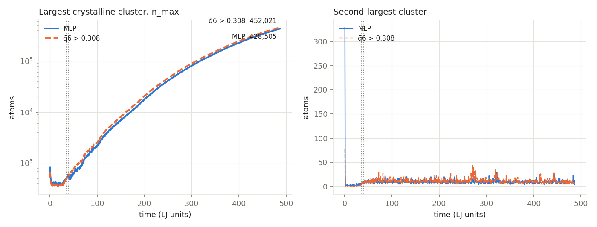

# In situ analysis (Phase 2 T2.4, T2.5; Phase 3 T3.1)

The MD code (`src/pmd.c`, CUDA forces) runs on a SIM communicator, and a separate group of CPU
analysis (ANA) ranks labels every atom as liquid or crystal on the fly and tracks the largest
crystalline cluster. Only labels and summary rows are written, not trajectories.

## Build and run

```bash
module load gcc/13.3.0 openmpi/5.0.5 cuda/12.6.3
make -C src                    # pmd, pmd_cuda, pmd_insitu (CUDA + -DINSITU), posthoc
make -C src pmd_insitu_cpu     # CPU forces + in situ (local tests; OMPFLAGS= without OpenMP)
srun -n <P_sim + P_ana> src/pmd_insitu <input>
```

Input keywords (in addition to the MD keywords in `docs/validation.md`):

| Keyword | Default | Meaning |
|---|---|---|
| `InsituRanks` | 0 | P_ana, # of ANA ranks (0 = analysis off, same binary) |
| `InsituInterval` | 100 | K, analysis every K steps |
| `InsituStart` | 0 | first step that may be analyzed |
| `InsituMovie` | 0 | full snapshot every M analysis steps (0 = off) |
| `InsituCheck` | 0 | 1 = full-precision dumps for the post hoc check |
| `InsituThr` | 0.308 | q̄6 threshold of the baseline labels |
| `InsituClusMin` | 20 | clusters with at least this many atoms are counted (`nbig`) |
| `InsituPrefix` | insitu | output file prefix |

The MPI size must be `vproc[0]*vproc[1]*vproc[2] + InsituRanks`.

## Design

```
MPI_COMM_WORLD (P_sim + P_ana ranks)
  MPI_Comm_split(color = rank < P_sim ? SIM : ANA)
    SIM: world ranks 0..P_sim-1, the MD code on simcomm (one GPU each)
    ANA: world ranks P_sim..P-1, CPU + OpenMP
  SIM rank s sends to ANA rank s*P_ana/P_sim
```

**SIM side, every K steps** (`insitu_send` in `pmd.c`, `insitu_sim_send` in `insitu.c`):

1. Copy the residents to separate arrays and run `halo_copy(2*r_q = 3.0, ...)`. This is
   `atom_copy` with the copy width as a parameter and the target arrays as arguments;
   `atom_copy()` is now `nb = halo_copy(RCUT, r, gid, NEMAX)`. The force cache `r[n:n+nb-1]`
   is not touched. A width of 2*r_q is what `steinhardt_compute` needs for exact q̄ at
   subdomain edges; the force cache (r_c = 2.5) is too thin.
2. `MPI_Wait` on the previous send (timed: this is the SIM stall), pack one `MPI_DOUBLE`
   message: a header (step, n_res, n_tot, subdomain origin in global coordinates, stall,
   halo and pack times, SIM rank), local positions of residents then halo atoms (the resident
   flag is the position in the block), and global IDs.
3. `MPI_Isend` to the ANA rank and keep integrating.

**ANA side** (`insitu_ana_run`):

1. For each assigned SIM rank in turn, `MPI_Probe` + `MPI_Get_count` + `MPI_Recv`. Receiving
   from specific sources keeps steps in order even when eager sends from fast SIM ranks arrive
   early.
2. `steinhardt_compute` on the block (OpenMP threads in passes 2 and 3), `steinhardt_features`,
   `mlp_classify_batch`, and the q̄6 > 0.308 baseline.
3. `MPI_Gatherv` of crystalline atoms (either label set: ID, global position, label bits) to ANA
   root.
4. Root sorts by ID and runs `cluster_find` (`src/cluster.c`: minimum image, bond if distance
   < r_q = 1.5, cell list, union-find) once per label set. It reports the largest and second
   largest cluster and the number of clusters with at least `InsituClusMin` atoms.
5. Root writes a summary row and appends to the label file; every M analysis steps it gathers
   all positions and writes a movie snapshot.

**Termination.** Both sides compute the same list of analysis steps from the input file
(`insitu_is_step`). Each SIM rank sends exactly one message per analysis step and waits for the
last one after the MD loop (`insitu_sim_finish`); each ANA rank receives exactly that many
messages from each of its SIM ranks and returns. There is at most one outstanding message per
SIM rank, so the end needs no extra handshake.

**GPU binding and placement.** The GPU is chosen by the rank index within the node on
*simcomm*, so ANA ranks never touch a GPU. On 2 nodes the job uses `srun --distribution=cyclic`:
world ranks 0..3 (SIM) land 2 per node, and ANA rank 4+s sits on the same node as SIM rank s.

## Output files

All binary files are little endian. `analysis/insitu_read.py` reads them.

| File | Content |
|---|---|
| `<prefix>_summary.dat` | one text row per analysis step (columns below) |
| `<prefix>_labels.bin` | per analysis step: `int32 step, int32 count, int32 id[count]` (ascending), `uint8 bits[count]`; crystalline atoms only |
| `<prefix>_movie_<step>.bin` | `int32 nglob, int32 step, double time, double box[3], float32 pos[nglob][3]` (ID order, wrapped), `uint8 bits[nglob]` |
| `<prefix>_full_<step>.bin` | check only: `int32 nglob, int32 step, double box[3], double pos[nglob][3]` in ID order (SIM rank 0) |
| `<prefix>_feat_<step>_a<k>.bin` | check only: in situ features of ANA rank k |

Label bits: 1 = MLP crystal, 2 = q̄6 > 0.308, 4 = in the largest MLP cluster, 8 = in the largest
threshold cluster.

Summary columns: `step time n_crystal_mlp n_crystal_thr nmax_mlp nmax_thr t_analysis t_stall
bytes_insitu | n2_mlp n2_thr nbig_mlp nbig_thr t_feat t_clus_io t_recvwait t_simhalo t_simpack
bytes_fulldump t_wall`. (`t_wall`, seconds since the ANA ranks started, was added after the
P100 run; with no stall, the difference between two rows is K times the MD step time.)

- `t_analysis`: max over ANA ranks of (features + labels + gather), plus the root's cluster
  and I/O time. Time spent waiting for SIM data is excluded and reported as `t_recvwait`.
- `t_stall`: max over SIM ranks of the `MPI_Wait` before this step's send.
- `t_simhalo`, `t_simpack`: max over SIM ranks of the analysis halo exchange and packing time,
  the other SIM-side cost of the analysis.
- `bytes_insitu`: bytes written so far by the in situ analysis (summary, labels, movie).
- `bytes_fulldump`: bytes a full-precision dump of all atoms at every analysis step would have
  needed by now (positions as doubles, IDs implicit by order: 24 bytes/atom + 32-byte header,
  exactly the `_full_` format). A text XYZ at `%.17g` would be about 3x larger.

## T2.5 Equivalence check: in situ vs post hoc

With `InsituCheck 1`, SIM rank 0 also writes a full-precision binary dump of all atoms at every
analysis step (doubles, the exact bits the SIM ranks hold, plus the subdomain origin), and each
ANA rank dumps its in situ per-atom features. `src/posthoc` then, for every analysis step:

- reads the dump and runs `steinhardt_compute_periodic` on the whole periodic box (periodic
  images, no subdomains),
- labels with `mlp_classify_batch` and q̄6 > 0.308 and runs the same `cluster_find`,
- compares labels atom by atom (by global ID), largest-cluster membership, crystal counts and
  n_max with the in situ label file and summary, and the five features and p_crystal with the in
  situ feature dumps.

Runs: `scripts/insitu_check.slurm`, inputs `runs/insitu_check/check_{2x1,4x2}.in`. N = 32000 at
the production state point (ρ* = 0.95, T_q = 0.70, seed R = 4.5), 10k hold steps, K = 100,
analysis from step 6000 to 17000 (111 steps: end of the melt, the quench and the growing seed).
CUDA build `pmd_insitu`, debug node e23-02 (2x P100), 2 OpenMP threads per ANA rank.
Results in `runs/insitu_check/results/`.

| Run | Decomposition | Atom labels compared | MLP mismatches | Threshold mismatches | Largest-cluster membership mismatches | n_max / counts mismatching steps |
|---|---|---|---|---|---|---|
| 2 SIM + 1 ANA | vproc 1 1 2 | 3,552,000 | 0 | 0 | 0 | 0 of 111 |
| 4 SIM + 2 ANA | vproc 2 2 1 | 3,552,000 | 0 | 0 | 0 | 0 of 111 |

**Agreement is exact** for both label sets and for the cluster sizes (for example n_max at step
17000: MLP 1128, threshold 1427 in the 2+1 run; 1551 and 1906 in the 4+2 run; the two runs are
different trajectories because the decomposition changes the floating-point summation order).

The features themselves are not bit-identical, and should not be expected to be:

| Run | max \|Δq̄4\| | max \|Δq̄6\| | max \|Δq4\| | max \|Δq6\| | max \|Δp_crystal\| | coordination mismatches |
|---|---|---|---|---|---|---|
| 2 SIM + 1 ANA | 7.9e-16 | 1.4e-15 | 3.1e-15 | 4.7e-15 | 2.3e-14 | 0 |
| 4 SIM + 2 ANA | 8.7e-16 | 1.5e-15 | 3.0e-15 | 4.7e-15 | 2.8e-14 | 0 |

Two things differ between the paths at the last-digit level: (1) the pair vectors. In situ, a
halo atom carries its owner's local coordinate shifted by one subdomain length, while post hoc
uses global coordinates and periodic images shifted by the box length, so r_ij is rounded
differently; and (2) the order in which neighbors are summed, which follows each path's own cell
grid. Both are round-off at 1e-15 relative. A label could flip only if an atom's q̄6 were within
~1e-15 of 0.308, or its MLP logits within ~1e-14 of each other, or a pair distance within ~1e-15
of r_q = 1.5. With 7.1M atom labels compared, none occurred. The positions used for the cluster
search are bit-identical on both paths (local + origin is computed the same way), so given equal
labels the clusters must agree. The same check also passed locally (CPU build) for 1 SIM + 1 ANA,
2 + 1, 4 + 2 and 4 + 3 ranks (uneven mapping).

The dumps also confirm that every atom is analyzed exactly once per step (each ID appears in
exactly one ANA feature file).

The trajectory itself is not perturbed by the analysis: on a 4000-atom test, the `pmd_insitu_cpu`
energies match the original `pmd` to all printed digits over 5000 steps.

## T3.1 Production seeded run

### What ran

The plan was 4 SIM ranks on 4 A100s (2 nodes, `scripts/production.slurm`, `runs/production/prod.in`).
The A100 jobs did not start: at submission there were about 200 eligible A100 jobs ahead in the
`gpu` queue, every 2-GPU node of every type was busy, and after more than 4 hours of waiting the
2-node A100 job (`14357822`) was still pending. A first version that asked for 16 cores per task
(whole nodes) was resubmitted with 6. To get a result inside the budget, the same 1M-atom run ran on
the one node that was available, the debug node e23-02, with the hold shortened to fit the 1 h
debug limit (`runs/production/prod_p100.in`).

| | |
|---|---|
| Node | e23-02 (debug): 2x Tesla P100 16 GB, Xeon E5-2640 v4 (20 cores) |
| N | 1,048,576 (4 x 64^3), ρ* = 0.95, box L = 103.4 |
| SIM ranks | 4 (vproc 2 2 1, 262,144 atoms each), 2 ranks per P100 |
| ANA ranks | 4 (1 per SIM rank), 2 OpenMP threads each |
| Protocol | melt T* = 2.0 for 5000 steps, ramp to T_q = 0.70 over 2000, hold; seed R = 4.5 (369 atoms) frozen to step 8000 |
| Analysis | every K = 100 steps from step 100; movie snapshot every 1000 steps |
| Steps | 97,400 of the planned 112,000 (hold steps 0 to 90,400); stopped by the 59 min time limit (job 14361069, TIMEOUT). Summary and label rows are flushed every analysis step, so all 974 analysis steps up to 97,400 are complete |
| Wall time | 59:09 including startup; 36.4 ms/step on average, about 37 ms/step in the hold |

The step time is slower than in the 4000-step smoke tests on the same node (26 to 28 ms/step, below).
The cause was not measured; the hold phase may simply be slower than the melt-dominated smoke
test. The `t_wall` summary column, added after this run, will let the next run separate the phases.

### n_max(t)



`analysis/plot_nmax.py runs/production/results/p100/prod_summary.dat docs/img/nmax_production_p100.png 35 40`
(dotted lines: start of the hold, seed release).

| Step | Hold step | t | n_max MLP | n_max q̄6 > 0.308 | crystalline MLP | crystalline q̄6 | t_analysis (s) |
|---|---|---|---|---|---|---|---|
| 7000 | 0 | 35 | 498 | 500 | 752 | 636 | 1.12 |
| 8000 | 1000 | 40 | 594 | 606 | 963 | 919 | 1.10 |
| 10000 | 3000 | 50 | 635 | 783 | 1,064 | 1,180 | 1.11 |
| 20000 | 13000 | 100 | 2,157 | 2,529 | 2,590 | 2,921 | 1.14 |
| 30000 | 23000 | 150 | 6,831 | 8,001 | 7,286 | 8,368 | 1.17 |
| 40000 | 33000 | 200 | 17,642 | 20,522 | 18,044 | 20,859 | 1.26 |
| 50000 | 43000 | 250 | 41,363 | 46,476 | 41,737 | 46,862 | 1.30 |
| 60000 | 53000 | 300 | 80,322 | 88,787 | 80,730 | 89,185 | 1.49 |
| 70000 | 63000 | 350 | 140,798 | 153,393 | 141,217 | 153,723 | 1.61 |
| 80000 | 73000 | 400 | 227,444 | 244,689 | 227,851 | 244,979 | 1.90 |
| 90000 | 83000 | 450 | 337,903 | 359,191 | 338,256 | 359,413 | 2.30 |
| 97400 | 90400 | 487 | 428,505 | 452,021 | 428,863 | 452,167 | 2.48 |

- **The seed grows** from about 600 atoms at release (the frozen 369-atom seed plus partly ordered
  surroundings, as noted in `docs/validation.md`) to 428,505 atoms (41% of the box) by the MLP and
  452,021 by the threshold, and it is still growing at the end. Growth is slow for the first
  ~10k hold steps and then speeds up as the surface grows. In this box the crystal does not reach
  its periodic images until late. In the 108k-atom box it filled half the box by 40k to 60k hold steps.
- **Both label sets agree on the shape of n_max(t).** The threshold cluster is 5 to 15% larger
  throughout. Nearly every crystalline atom belongs to the largest cluster (n_crystal - n_max is a
  few hundred atoms), so the extra threshold atoms sit on the crystal surface: the q̄6 threshold
  calls more interface atoms crystalline than the MLP does, consistent with `docs/classifier.md`.
- **No spontaneous nucleation.** After the seed release, the second-largest cluster never exceeds
  34 atoms (MLP) or 43 atoms (threshold), and at most 2 (MLP) or 3 (threshold) clusters of at
  least 20 atoms exist at any analysis step, the seed's cluster included. These are transient
  fluctuations, consistent with the unseeded control at T_q = 0.70 in `docs/validation.md` (largest
  solid cluster at most 12 atoms with the stricter ten Wolde criterion).

### Cost of the analysis

Over the 974 analysis steps (K = 100):

| Quantity | Value |
|---|---|
| K x step time (MD time between analysis steps) | about 3.7 s |
| t_analysis (max over ANA ranks + root clustering and I/O) | mean 1.36 s, max 2.61 s (grows with the crystal: 1.1 s early, 2.5 s at the end) |
| of which features + MLP (t_feat) | mean 1.04 s (262k residents + ~85k halo atoms per ANA rank, 2 threads) |
| of which root cluster search + label/movie I/O | mean 0.32 s, max 1.52 s (movie steps) |
| ANA idle time waiting for SIM data (t_recvwait) | min 1.61 s, mean 2.63 s per analysis step |
| SIM stall (MPI_Wait before the next send, max over SIM) | total 1.0 ms over all 974 sends, max 4 µs |
| SIM analysis halo exchange + packing (max over SIM) | 7.0 ms + 1.5 ms per analysis step = 0.085 ms/step (0.2% of the step) |

The analysis takes at most 70% of the MD time between analysis steps, so it never holds the SIM
ranks back: the stall is zero. The ANA ranks are idle at least 1.6 s of every 3.7 s cycle.

Same node, analysis on vs off (`runs/production/smoke*.in`, N = 1,048,576, 4000 steps: melt 1000,
ramp 500, hold 2500):

| Run | step time (ms) |
|---|---|
| analysis off (`InsituRanks 0`, 4 SIM ranks only) | 25.56 |
| analysis on, run 1 (job 14360128) | 27.75 |
| analysis on, run 2 (job 14362120) | 26.43 |

With analysis on, the step time is 3 to 9% higher (one off run, two on runs, so the spread is
noise of the same size). The SIM-side work that the analysis adds (halo + pack, 0.085 ms/step) and
the stall (0) explain almost none of it. The rest is the ANA ranks sharing the node's 20 cores and
memory bandwidth with the SIM ranks' host work (packing, migration, integration), which is half of
the step at this N (`docs/validation.md`). Placing ANA ranks on separate nodes would remove that,
at the cost of inter-node transfers (about 11 MB per SIM rank per analysis step here).

### I/O: in situ vs full dump

| | Bytes |
|---|---|
| In situ total (summary + labels + 97 movie snapshots) | 1.85 GB |
| of which label file (crystalline atoms only, 5 bytes each) | 0.53 GB |
| of which movie snapshots (13 bytes/atom, every 1000 steps) | 1.32 GB |
| of which summary | 0.13 MB |
| Full-precision dump of all atoms every K = 100 steps (24 bytes/atom) | 24.5 GB |

The in situ output is 13x smaller than the full dump at the same frequency, movie included, and
46x smaller without the movie. The label file grows with the crystal: while the crystal is small,
a step costs a few kB instead of 25 MB. For a crystal that fills the box, the labels alone would
approach 5 MB per step, 5x smaller than the dump. The 13-byte movie frames are float32
and would not support the equivalence check, which is why the check uses the separate
double-precision `_full_` dumps.

### Where the data is

On CARC (`~/insitu-nucleation-md` = `/home1/mvardhan/insitu-nucleation-md`):

| Path | Content | Size |
|---|---|---|
| `runs/production/out_p100/prod_movie_<step>.bin` | 97 movie snapshots, steps 1000 to 97000 (all atoms, float32 positions + label bits) | 1.32 GB |
| `runs/production/out_p100/prod_labels.bin` | labels of crystalline atoms, 974 analysis steps | 0.53 GB |
| `runs/production/out_p100/prod_summary.dat`, `run.log` | summary, MD log | small |
| `runs/production/smoke_debug/`, `smoke_p100/`, `smoke_noana_p100/` | 1M-atom smoke tests (4 movie frames each) | 0.1 GB |
| `runs/insitu_check/out_2x1/`, `out_4x2/` | T2.5 dumps and in situ output | 0.5 GB |

In this repository: `runs/production/results/p100/` (summary, log, input, slurm output),
`runs/production/results/smoke_debug/`, `runs/insitu_check/results/`.

For the movie: `analysis/insitu_read.py: read_movie()` returns positions (wrapped into the box) and
bits per atom in ID order. bit 1 = MLP crystal and bit 4 = largest MLP cluster are the natural
coloring. Showing only crystalline atoms plus a thin slab of liquid keeps the frames light.

### Still queued

The A100 production job `14357822` (`scripts/production.slurm`, default input `prod.in`: the same
run on 4 A100s over 2 nodes with the full 150k-step hold) is still pending in the `gpu` queue and
will write to `runs/production/out/` on CARC if it starts (about 2.5 GB). It uses the current
binary, with the `t_wall` column.
