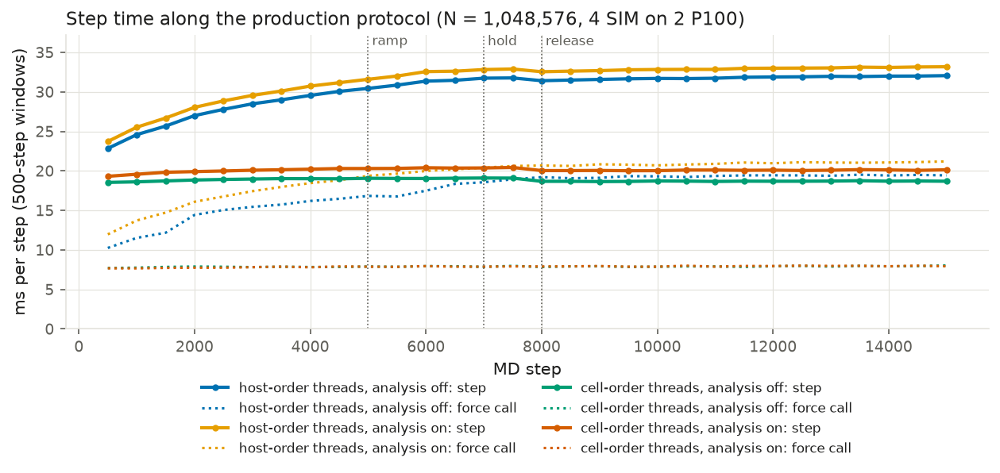
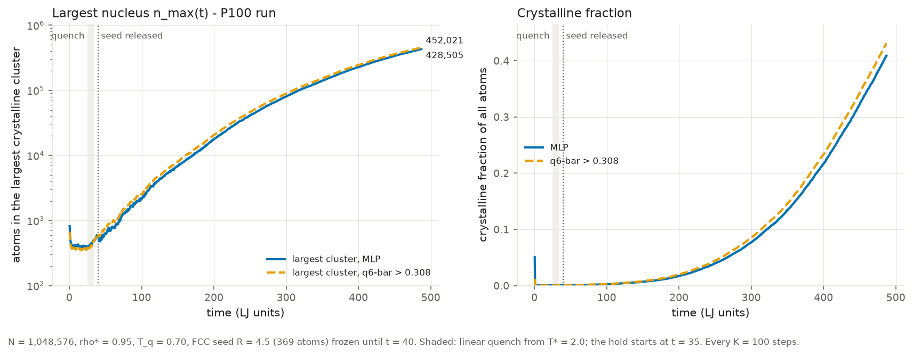
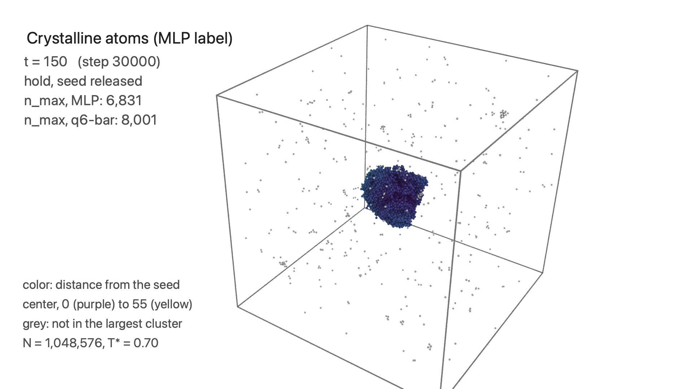
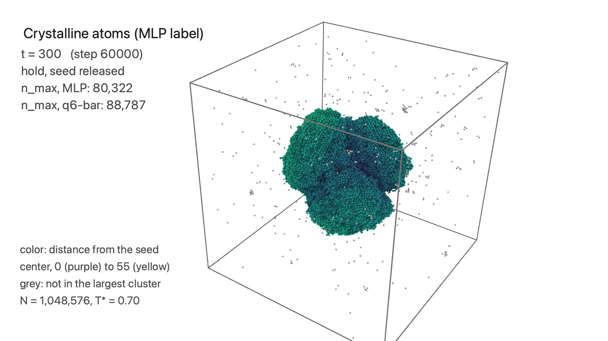
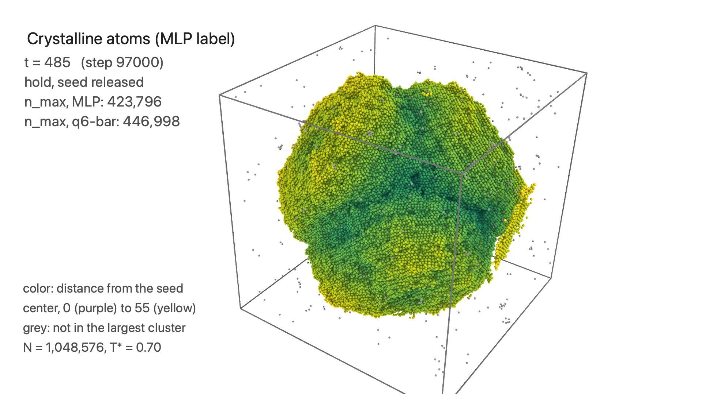
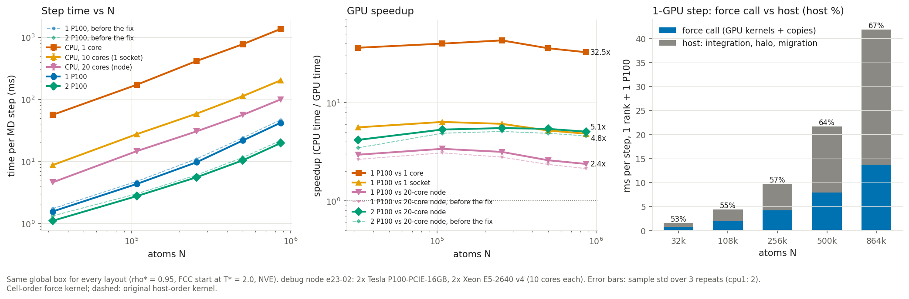
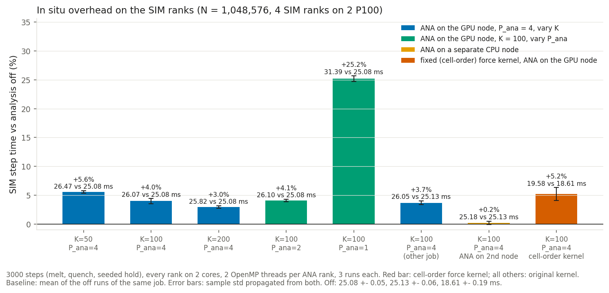

# CSCI 596 Final Project Report

## In Situ Machine-Learning Nucleation Detection in GPU Molecular Dynamics

Manas Vardhan, November 19, 2026

**Project option:** I, Programming. **Student:** Manas Vardhan, MS Computer Science, USC (mvardhan@usc.edu). **Instructor:** Prof. Aiichiro Nakano. **Submission:** repository URL on Brightspace by December 11, 2026.

| Link | URL |
| --- | --- |
| GitHub repository (all code, data, scripts, this report) | [github.com/ManasVardhan/insitu-nucleation-md](https://github.com/ManasVardhan/insitu-nucleation-md) |
| Project website (live simulation sketch, interactive figures) | [manasvardhan.com/insitu-nucleation-md](https://manasvardhan.com/insitu-nucleation-md/) |
| Full technical report (README) | [README.md](../README.md) |

## Abstract

This project extends the course parallel MD code `pmd.c` into a GPU-accelerated MPI + CUDA simulation of 1,048,576 Lennard-Jones atoms, and adds dedicated in situ analysis ranks that label every atom liquid or crystal while the simulation runs, so the trajectory never has to be written to disk. The MPI job is split into simulation (SIM) ranks, one per GPU, and analysis (ANA) ranks on CPU cores. Every 100 steps each SIM rank sends its atoms plus a 3.0 sigma halo to an ANA rank with a nonblocking message and keeps stepping. The ANA ranks compute Steinhardt bond-order features (q4, q6, averaged q4 and q6, coordination), run a 402-parameter neural network in plain C to classify each atom, and track the largest crystalline cluster with a periodic union-find.

On two Tesla P100 GPUs on USC CARC, the in situ labels match a post hoc analysis of a full dump exactly (0 mismatches in 7,104,000 labels). A seeded supercooled liquid at T\* = 0.70 grew from a 369-atom FCC seed to 428,505 crystalline atoms (40.9% of the box) with no second nucleus. One P100 is 33 to 43x faster than one CPU core and 2.4 to 3.4x faster than the whole 20-core node; two P100s give 1.70x strong-scaling speedup at one million atoms. A GPU kernel bug found along the way (thread order drifting away from spatial order as the liquid diffuses) was fixed for a 1.7x step-time gain with bit-identical forces. The in situ analysis adds 5.2% to the step time on the same node and 0.2% when the analysis ranks sit on a separate node, and it writes 13.2x less data than a trajectory dump (46.4x for labels only).

## 1. Goal and problem statement

The goal is to catch crystal nucleation in a million-atom molecular dynamics run while it happens, without storing the trajectory.

Crystallization of a supercooled liquid begins with a rare, short-lived event: a nanometer-sized crystal nucleus forms somewhere in a large volume of disordered atoms and either dissolves or grows. MD resolves this atom by atom, but the place and time of the event are unknown in advance. The usual workflow therefore writes the full trajectory to disk at high frequency and searches it afterwards. At scale this makes I/O, not computation, the bottleneck: compute has grown much faster than file-system bandwidth, and most of the stored data describes nothing interesting. For the run in this project, a full-precision dump every 100 steps would have been 24.5 GB for one hour of simulation.

Stated plainly, the problem has three parts, and each suggests its own solution:

1. The simulation is too slow on CPUs at this size. Move the force computation to GPUs with CUDA, keeping the spatial decomposition and MPI logic of the course code.
2. The interesting quantity, the size of the largest crystalline cluster n_max(t), is a function of the whole box at each moment. Compute it in flight on dedicated analysis ranks that receive atom positions asynchronously, so the simulation never waits.
3. Deciding whether an atom is crystalline needs a local, rotation-invariant measure of order and a classifier that is cheap enough to run inside the MPI job. Use Steinhardt bond-order parameters and a very small neural network exported to C, always compared with a threshold baseline.

Why it matters beyond this system: the pattern (simulate on GPUs, understand the result in flight, store only what matters) carries over to any large simulation whose interesting events are rare and whose raw output is too large to keep.

## 2. Specific objectives

The project was planned as a step-by-step path from the course code to a validated in situ pipeline, with each step checked before the next.

1. Extend the course `pmd.c` with global atom IDs, a keyword input file, a Berendsen thermostat, and a melt, quench, hold and seed protocol. Check: identical energies to the original code.
2. Move the Lennard-Jones force computation to the GPU with a CUDA cell-list kernel. Check: GPU and CPU forces agree to better than 1e-10 relative error, NVE energy drift below 1e-4 per atom, liquid g(r) matches the literature.
3. Build the Steinhardt feature code and the cluster search as standalone C with unit tests. Check: perfect FCC values of q4 and q6, rotation and ordering invariance, agreement with an O(N squared) reference.
4. Generate training data with the same code, train a small MLP in PyTorch, export it to a C header, and compare with a q6-bar threshold. Check: C forward pass matches PyTorch, above 95% held-out accuracy.
5. Split the MPI job into SIM and ANA communicators with nonblocking transfers and a 2 r_q analysis halo. Check: in situ labels identical to a post hoc analysis of a full dump of the same run, and the analysis does not perturb the trajectory.
6. Run a seeded million-atom production run on CARC, tracking n_max(t) in situ, and render the growing crystal with OVITO.
7. Measure GPU speedup against one core and against the full node, strong and weak scaling, the in situ overhead as a function of the analysis interval K and the number of analysis ranks, and the bytes written versus a full dump.
8. Publish everything: a reproducible repository, a technical README, and a project website with a live sketch of the run.

All eight objectives were completed. Objective 7 was limited to one GPU node (see section 6).

## 3. Background and previous work

The project sits at the meeting point of four established lines of work; its contribution is combining them in one GPU MPI job and measuring the cost.

**Crystal nucleation in MD.** MD has studied phase transitions since Alder and Wainwright's hard-sphere simulations [1] and Rahman's liquid argon [2], which introduced the Lennard-Jones liquid used here. In classical nucleation theory a supercooled liquid must form a nucleus larger than a critical size before the crystal can grow; reaching it is a rare fluctuation, so a run can go a long time with nothing happening and then nucleate in a short window at an unknown place [3, 4]. Biased sampling methods such as umbrella sampling on the size of the largest cluster [3, 5] were built for this rarity. The quantity they all track, n_max(t), is the one this project computes on the fly.

**In situ analysis.** Because compute has outgrown file-system bandwidth, analysis that runs while the data is still in memory has become standard on large machines [6, 7]. Approaches range from in-line analysis inside the simulation process to in-transit analysis on dedicated resources that receive data asynchronously. This project uses the second form inside a single MPI job, following the processor-grouping pattern taught in class: a fixed group of ranks receives positions by nonblocking messages so the simulation keeps stepping.

**Steinhardt bond-order parameters.** Steinhardt, Nelson and Ronchetti [8] defined rotation-invariant local order measures q_l from spherical harmonics over an atom's neighbors; they take characteristic values in ordered environments (FCC: q4 = 0.191, q6 = 0.575) and small values in a liquid. ten Wolde, Ruiz-Montero and Frenkel [3] used normalized q6 vectors to define solid-like atoms in LJ nucleation. Lechner and Dellago [9] showed that averaging q_lm over an atom and its neighbors (q-bar) separates the phases far more sharply, at the cost of needing a second neighbor shell, which is why the analysis halo here is 2 r_q.

**Machine-learning classifiers for local structure.** A threshold on q6-bar works for bulk FCC versus liquid but becomes ambiguous at interfaces and with several crystal structures. Neural networks on symmetry-function descriptors were proposed by Geiger and Dellago [10], and later work learned structure directly from neighbor coordinates [11]. Here the classifier is deliberately tiny (402 parameters) so that it runs in plain C inside the MPI job, and it is always compared with the threshold baseline.

**Course foundations.** The simulation is built on the course code `pmd.c` (spatial decomposition, atom caching from six neighbors, atom migration [13]) and the course material on MPI communicators, hybrid MPI + OpenMP, CUDA, and in situ visualization.

## 4. Methods

### 4.1 Physical model and protocol

Lennard-Jones atoms in reduced units, force-shifted at r_c = 2.5, velocity Verlet, periodic boundaries, linked-list cells, and a Berendsen thermostat applied globally through an all-reduce. The liquid is melted at T\* = 2.0, quenched linearly to T\* = 0.70 and held; a spherical FCC seed of 369 atoms (radius 4.5 sigma) at the box center is frozen until shortly after the quench and then released. The quench point and seed size were chosen with smoke tests: at T\* = 0.70 an unseeded liquid stays liquid, seeds of 55 and 87 atoms melt, and seeds of 249 and 369 atoms grow.

| Parameter | Production value |
| --- | --- |
| Atoms N | 1,048,576 (4 x 64 cubed FCC cells) |
| Density | 0.95 (box L = 103.4 sigma) |
| Time step | 0.005 |
| Melt | T\* = 2.0 for 5,000 steps |
| Quench | linear ramp to 0.70 over 2,000 steps |
| Hold | T\* = 0.70, 105,000 steps planned, 90,400 reached |
| Seed | 369-atom FCC sphere, frozen until step 8,000 |
| Analysis | every K = 100 steps, r_q = 1.5, movie frame every 1,000 steps |
| Layout | 4 SIM ranks on 2 P100 GPUs, 4 ANA ranks with 2 OpenMP threads each |

### 4.2 Parallel architecture: the SIM/ANA split

The MPI world is split with one communicator call into SIM ranks (one GPU each, running the course spatial decomposition) and ANA ranks (CPU plus OpenMP). Every step the SIM ranks exchange a halo of width r_c with six neighbors, migrate atoms, compute forces on the GPU, and integrate on the host. Every K steps they run a second halo exchange of width 2 r_q = 3.0, wait on the previous send (timed as the stall), pack residents plus halo plus global IDs into one block, post a nonblocking send to their ANA rank, and keep stepping. Each SIM rank has at most one message in flight, both sides compute the same list of analysis steps from the input, and the run ends without a handshake.

```
MPI_COMM_WORLD (P_sim + P_ana ranks)
  └─ MPI_Comm_split(color = rank < P_sim ? SIM : ANA)

SIM communicator: P_sim ranks, 1 GPU each       (spatial decomposition, course pmd.c)
  every step
    halo exchange of width r_c with 6 neighbors, atom migration           (host, MPI)
    LJ forces: copy coordinates to GPU, cell sort, kernel, copy back      (CUDA)
    velocity Verlet, thermostat                                           (host)
  every K steps
    second halo exchange of width 2 r_q = 3.0                             (host, MPI)
    MPI_Wait on the previous send (timed as the stall)
    pack residents + halo + global IDs, MPI_Isend, keep stepping
                    │
                    │  one message per SIM rank per analysis step
                    ▼
ANA communicator: P_ana ranks, CPU + OpenMP
  every K steps, for each assigned SIM rank
    MPI_Probe + MPI_Recv the block
    q4, q6, q̄4, q̄6, coordination (steinhardt.c)
    labels: MLP 5-16-16-2 (mlp.c) and the baseline q̄6 > 0.308
  MPI_Gatherv of crystalline atoms to ANA root
  root: periodic cluster search (union-find), n_max, summary row,
        label file, movie frame every 10 analysis steps

Output: <prefix>_summary.dat, <prefix>_labels.bin, <prefix>_movie_<step>.bin (no trajectory)
```

SIM ranks hand each block to an ANA rank with a nonblocking send and keep stepping; only labels and summaries reach the disk.

### 4.3 Why the analysis halo is 2 r_q

The averaged order parameter q-bar of atom i uses the q_lm of i and of every neighbor within r_q, and each neighbor's q_lm needs that neighbor's full shell. An ANA rank therefore needs every atom within 2 r_q = 3.0 of its subdomain, thicker than the force cache. A unit test shows the consequence of getting this wrong: with a halo of only r_q, q6 stays exact but q6-bar is wrong by up to 1.7e-2 at the edges.

### 4.4 CUDA force path and the cell-order fix

Only the force computation moves to the GPU; everything else stays on the host, so the MPI logic is identical to the CPU code and the two paths can be compared directly. Each step a SIM rank copies resident plus cached coordinates to the device, bins them into the same cell grid as the CPU path, sorts by cell with CUB radix sort, computes forces and per-atom energy in double precision with one thread per resident atom over all neighbor cells (no Newton's third law, so no atomics), and copies forces back. GPU and CPU forces agree to 8.0e-14 relative error.

The first kernel launched one thread per atom in host array order. At the start that order is the FCC lattice, so a warp's 32 threads handle neighboring atoms and read the same few cells. As the liquid diffuses, host order stops matching space, each thread walks different cells, and the force call slowed from 10.3 to 19.4 ms per rank over the first 7,000 steps. The fix lets thread s handle atom s of the cell sort the kernel already does, so a warp always covers one region of space. Each atom still sums the same cells in the same order, so forces are bit-identical, and the hold-phase step time drops from 31.8 to 18.7 ms (1.7x).



### 4.5 Classifier and training data

Training data comes from the project's own serial LJ generator: thermalized FCC crystals and quenched liquids at 12 state points (279,936 atoms). The test set uses 6 state points between the training grid values (139,968 atoms), so no test state is seen in training; crystal/liquid slabs (49,152 atoms) are used only to evaluate at an interface. Features are [q4-bar, q6-bar, q4, q6, coordination] from the same `steinhardt.c` that runs in situ. The model is an MLP 5 to 16 to 16 to 2 with ReLU (402 parameters), trained in PyTorch in about 5 s and exported to a C header; the hand-written C forward pass matches PyTorch to 1.8e-15 with 0 label mismatches. The baseline is a single threshold q6-bar > 0.308 fitted on the training set.

### 4.6 Cluster detection and output

The ANA root gathers the crystalline atoms, finds connected clusters across periodic boundaries with union-find, and writes one summary row per analysis step (n_max for both label sets, crystalline fraction, timings), a compact label file (5 bytes per crystalline atom), and a movie frame every 10 analysis steps. No trajectory is written.

## 5. Results

All measurements ran on CARC Discovery with the code in the repository. Every GPU number comes from one node, debug node e23-02 (2x Tesla P100-PCIE-16GB, 2x Xeon E5-2640 v4 with 10 cores each), the only GPU node that could be scheduled in the project window. Times are wall-clock ms per MD step; plus or minus is the sample standard deviation over three repeats.

### 5.1 Validation: every piece checked before use

| Check | Result |
| --- | --- |
| Extended code vs original `pmd.c` | same energies to all printed digits; every global ID owned by exactly one rank |
| GPU vs CPU forces | 8.0e-14 max relative error |
| NVE energy drift, 10k steps | 1.8e-5 per atom (GPU), 1.7e-5 (CPU) |
| Liquid g(r) at T\* = 0.722, density 0.8442 | first peak 1.085, first minimum 1.535, second peak 2.045, matching the standard LJ liquid [14, 15] |
| Steinhardt features on perfect FCC | q4 = 0.19094065, q6 = 0.57452426; invariances to 4.0e-15; matches an O(N squared) reference to 6.1e-16 |
| C MLP vs PyTorch | max logit difference 1.8e-15, 0 mismatches in 2,000 |
| In situ vs post hoc | 0 mismatches in 3,552,000 labels for each of two layouts (2 SIM + 1 ANA, 4 SIM + 2 ANA), both label sets, cluster membership and n_max at all 111 steps |
| Analysis does not perturb the trajectory | in situ binary matches plain MD to all printed digits over 5,000 steps |
| Cell-order kernel vs original | energies agree to all printed digits over 3,000 steps |

### 5.2 Science: the nucleus grows and nothing else nucleates

The production run (job 14361069) ran before the kernel fix at 36.4 ms per step and was stopped by the 1-hour debug limit at step 97,400 of 112,000; all 974 analysis steps up to the cut are complete. The released seed grows steadily and is still growing when the run ends, from 594 atoms at seed release (t = 40) to 428,505 atoms (40.9% of the box) at t = 487. After t of about 200 the cube root of n_max grows almost linearly, so the interface moves at a roughly constant speed. No other nucleus forms: the second-largest cluster never exceeds 34 atoms (MLP) or 43 (threshold). The q6-bar threshold always finds a 5 to 23% larger cluster, and the movie shows where the surplus sits: on the crystal surface and at internal defects between lobes, matching the interface bias measured in the classifier evaluation.



| t (LJ time) | n_max, MLP | n_max, q6-bar > 0.308 | crystalline fraction, MLP |
| --- | --- | --- | --- |
| 40 (seed release) | 594 | 606 | 0.09% |
| 100 | 2,157 | 2,529 | 0.25% |
| 200 | 17,642 | 20,522 | 1.7% |
| 300 | 80,322 | 88,787 | 7.7% |
| 400 | 227,444 | 244,689 | 21.7% |
| 487 (last) | 428,505 | 452,021 | 40.9% |

| t = 150 | t = 300 | t = 485 |
| --- | --- | --- |
|  |  |  |

### 5.3 GPU speedup

| N | CPU 1 core | CPU 20 cores | 1 P100 | 2 P100 | 1 P100 vs 1 core | 1 P100 vs node | 2 P100 vs node |
| --- | --- | --- | --- | --- | --- | --- | --- |
| 32,000 | 56.32 | 4.61 | 1.56 | 1.11 | 36.0x | 2.9x | 4.2x |
| 108,000 | 171.98 | 14.65 | 4.33 | 2.76 | 39.7x | 3.4x | 5.3x |
| 256,000 | 413.85 | 30.43 | 9.67 | 5.54 | 42.8x | 3.1x | 5.5x |
| 500,000 | 772.32 | 56.09 | 21.68 | 10.39 | 35.6x | 2.6x | 5.4x |
| 864,000 | 1358.82 | 99.41 | 41.86 | 19.67 | 32.5x | 2.4x | 5.1x |

One P100 is 33 to 43x faster than one core, but the fair comparison is the whole node: one P100 beats all 20 cores by 2.4 to 3.4x and both P100s by 4.2 to 5.5x. The force call is now 16 to 23 ns per atom, and the host work around it (integration, halo packing, migration on one core per rank) is 53 to 67% of the 1-GPU step, so the GPU advantage shrinks at large N. In a melting liquid the old kernel lost a third of its speed and the new one does not: at N = 256,000 one P100 is 3.0x the node with the fix and 2.0x without.



### 5.4 Strong and weak scaling

| Strong scaling | P = 1 | P = 2 | Speedup | Efficiency |
| --- | --- | --- | --- | --- |
| GPU, N = 1,048,576 | 51.73 ms | 30.50 ms | 1.70x | 0.85 |
| GPU, N = 1,048,576, 4 ranks sharing 2 P100 (production layout) | 51.73 ms | 23.58 ms | 2.19x | 1.10 per GPU |
| GPU, N = 256,000 | 9.69 ms | 6.08 ms | 1.60x | 0.80 |
| CPU, N = 256,000, 1 to 20 cores | 416.86 ms | 30.29 ms (P = 20) | 13.8x | 0.69 |

Going from 1 to 2 P100s halves the force call (16.3 to 8.7 ms at 1M atoms) but not the host part (33.4 to 19.5 ms) or the halo exchange, so the efficiency is 0.85. Two ranks per GPU is faster still (2.19x) because it spreads the host work over four cores: the host, not the GPU, limits the step. Weak scaling efficiency is 0.73 on 2 P100s at 262,144 atoms per GPU and 0.75 on 20 cores at 32,000 atoms per core.

### 5.5 In situ overhead

| Configuration | Kernel | SIM ms/step, off to on | Overhead | SIM stall |
| --- | --- | --- | --- | --- |
| K = 100, 4 ANA ranks on the GPU node | cell-order | 18.61 to 19.58 | +5.2 ± 1.1% | 0 |
| K = 100, 4 ANA ranks on the GPU node | original | 25.08 to 26.07 | +4.0 ± 0.4% | 0 |
| K = 50 / 200, 4 ANA ranks | original | 25.08 to 26.47 / 25.82 | +5.6% / +3.0% | 0 |
| K = 100, 4 ANA ranks on a separate CPU node | original | 25.13 to 25.18 | +0.2 ± 0.3% | 0 |
| K = 100, 2 ANA ranks | original | 25.08 to 26.10 | +4.1% | 0 |
| K = 100, 1 ANA rank | original | 25.08 to 31.39 | +25.2% | 13.6 s |

Three conclusions follow. First, on the same node the analysis costs about 1 ms per step, and that cost comes from sharing the node, not from the protocol: the work added on the SIM side is 0.075 ms per step, the SIM ranks never wait, and moving the ANA ranks to a separate node removes the cost entirely. Second, the kernel fix did not change the cost in milliseconds (0.97 vs 0.99 ms), only its share of a shorter step. Third, the number of ANA ranks decides whether the analysis keeps up: with 2 or 4 it fits in the MD time between analysis steps; with 1 it does not, every SIM rank blocks on its previous send, and the step time grows 25%. In the production run the cluster search on ANA root grows with the crystal, so the analysis time rises from 1.1 to 2.5 s against 3.6 s of MD per interval; a longer run would start to stall at a crystalline fraction of about 0.75.



### 5.6 I/O savings

| Production run, 974 analysis steps | Bytes | vs full dump |
| --- | --- | --- |
| Full-precision dump of all atoms every K steps (24 B per atom) | 24.51 GB | 1x |
| In situ: labels, summary and 97 movie frames | 1.85 GB | 13.2x smaller |
| In situ: labels and summary only | 0.53 GB | 46.4x smaller |

The labels cost 0.52 bytes per atom per analysis step on average, against 24 for the dump. Both costs are linear in N, so the ratio depends on the crystalline fraction and on K, not on N.

### 5.7 Classifier accuracy

| Accuracy | MLP | q6-bar threshold |
| --- | --- | --- |
| Held-out bulk state points | 99.94% | 99.88% |
| Slab, all atoms | 95.4% | 95.7% |
| Slab, within 1 sigma of the interface | 73.7% | 75.0% |

In bulk the MLP makes half as many errors as the threshold; at an interface it does not beat it.

## 6. Limitations and future work

The main limitation is that every GPU number comes from one node with two P100s.

- **GPU scaling stops at 2 P100s.** V100 and A100 nodes in the gpu partition could not be scheduled during the project window. A multi-node scaling job (1 to 8 V100 over 4 nodes) and the planned 4-A100 production run were still pending in the queue when this report was written.
- **The production run used the original kernel and was cut short** by the 1-hour debug limit at step 97,400 of 112,000. The physics is unaffected because the fix gives bit-identical forces.
- **The classifier does not beat the baseline at interfaces** (73.7% vs 75.0% within 1 sigma), and both place the interface 0.5 to 1 sigma into the liquid, inflating n_max by about one surface shell. With these five features nearly all the information is in q6-bar.
- **The GPU path is host-bound.** Integration, halo packing and migration run on one core per rank and take 53 to 67% of the 1-GPU step.
- **Seeded, not homogeneous, nucleation**, so the run does not measure a nucleation rate.
- **Some causes are inferred, not measured**, such as the per-core slowdown of the CPU path when a socket is busy and the constant 0.5 ms in situ cost at any K.

Future work, in order of expected payoff:

1. Keep positions, velocities and the integrator on the GPU and transfer only halos and migrating atoms, removing the host work that now limits the step.
2. Run unseeded homogeneous nucleation at T\* = 0.55, where a 108k-atom liquid nucleates on its own within 15k to 25k hold steps, to obtain a rate and the location of spontaneous nuclei.
3. Train an interface-aware classifier and parallelize the cluster search, which now runs on ANA root and grows with the crystal.
4. Run the pending multi-node A100 jobs with the fixed kernel and the ANA ranks on their own nodes.

## 7. Repository guide

Everything needed to rebuild the results is in [github.com/ManasVardhan/insitu-nucleation-md](https://github.com/ManasVardhan/insitu-nucleation-md); the README is the full technical report and the website at [manasvardhan.com/insitu-nucleation-md](https://manasvardhan.com/insitu-nucleation-md/) presents the same results interactively.

| Directory | Contents |
| --- | --- |
| `src/` | `pmd.c` (course code plus thermostat, protocol, seed, CUDA path, in situ send), `force_cuda.cu` (cell-list LJ kernel with cell-order threads), `insitu.c` (SIM/ANA split, transfers, ANA loop, output), `steinhardt.c`, `mlp.c` and the exported weights, `cluster.c` (periodic union-find), `posthoc.c` (equivalence check), Makefile |
| `train/` | serial LJ training-data generator, PyTorch training and export scripts, trained model and results |
| `tests/` | unit tests: Steinhardt features, MLP parity with PyTorch, cluster search (no MPI or GPU needed) |
| `scripts/` | Slurm job scripts for CARC: validation, smoke, production, every performance experiment |
| `analysis/` | readers for the in situ output and every plot in the report |
| `viz/` | frame extraction and OVITO rendering for the movie and stills |
| `runs/` | inputs and results: validation, smoke, nucleation, in situ check, production, performance CSVs and Slurm logs |
| `docs/` | design, plan, abstract, validation, classifier, in situ and results write-ups; figures and media |
| `site/` | the project website, deployed by GitHub Pages |

Build on CARC Discovery with a login shell:

```bash
git clone https://github.com/ManasVardhan/insitu-nucleation-md.git
cd insitu-nucleation-md
module load gcc/13.3.0 openmpi/5.0.5 cuda/12.6.3
make -C src          # pmd (CPU), pmd_cuda, pmd_insitu (CUDA + in situ), posthoc
cd tests && make test
```

A single run is `srun -n <P_sim + P_ana> src/pmd_insitu <input>` with a keyword input file. The production run, the in situ versus post hoc check, and each performance experiment have their own Slurm script under `scripts/`, and the README section "Reproduce" lists the exact commands and job IDs behind every number in this report.

## Acknowledgments

The simulation is built on the course MD code `pmd.c` and `pmd.h` by Prof. Aiichiro Nakano (spatial decomposition, atom caching and migration), provided as course base code, and the SIM/ANA split follows the processor-grouping pattern taught in class. Computation was done on the Discovery cluster of the USC Center for Advanced Research Computing (CARC).

## References

1. B. J. Alder and T. E. Wainwright, "Phase transition for a hard sphere system," *J. Chem. Phys.* **27**, 1208 (1957).
2. A. Rahman, "Correlations in the motion of atoms in liquid argon," *Phys. Rev.* **136**, A405 (1964).
3. P. R. ten Wolde, M. J. Ruiz-Montero, and D. Frenkel, "Numerical calculation of the rate of crystal nucleation in a Lennard-Jones system at moderate undercooling," *J. Chem. Phys.* **104**, 9932 (1996).
4. G. C. Sosso et al., "Crystal nucleation in liquids: open questions and future challenges in molecular dynamics simulations," *Chem. Rev.* **116**, 7078 (2016).
5. S. Auer and D. Frenkel, "Prediction of absolute crystal-nucleation rate in hard-sphere colloids," *Nature* **409**, 1020 (2001).
6. H. Childs et al., "A terminology for in situ visualization and analysis systems," *Int. J. High Perform. Comput. Appl.* **34**, 676 (2020).
7. J. C. Bennett et al., "Combining in-situ and in-transit processing to enable extreme-scale scientific analysis," *Proc. SC12* (2012).
8. P. J. Steinhardt, D. R. Nelson, and M. Ronchetti, "Bond-orientational order in liquids and glasses," *Phys. Rev. B* **28**, 784 (1983).
9. W. Lechner and C. Dellago, "Accurate determination of crystal structures based on averaged local bond order parameters," *J. Chem. Phys.* **129**, 114707 (2008).
10. P. Geiger and C. Dellago, "Neural networks for local structure detection in polymorphic systems," *J. Chem. Phys.* **139**, 164105 (2013).
11. R. S. DeFever et al., "A generalized deep learning approach for local structure identification in molecular simulations," *Chem. Sci.* **10**, 7503 (2019).
12. H. J. C. Berendsen et al., "Molecular dynamics with coupling to an external bath," *J. Chem. Phys.* **81**, 3684 (1984).
13. S. Plimpton, "Fast parallel algorithms for short-range molecular dynamics," *J. Comput. Phys.* **117**, 1 (1995).
14. L. Verlet, "Computer 'experiments' on classical fluids. II. Equilibrium correlation functions," *Phys. Rev.* **165**, 201 (1968).
15. D. Frenkel and B. Smit, *Understanding Molecular Simulation*, 2nd ed. (Academic Press, 2002).
16. A. Stukowski, "Visualization and analysis of atomistic simulation data with OVITO, the Open Visualization Tool," *Modelling Simul. Mater. Sci. Eng.* **18**, 015012 (2010).
