# Results (Phase 3: T3.2 measurements, T3.3 figures and movie)

All numbers below are measured on CARC Discovery with the code in this repository. Raw timing CSVs
(one row per run), in situ summaries and Slurm logs are in `runs/perf/results/`. The figures are made
by `analysis/plot_perf.py` (performance), `analysis/plot_io.py` (I/O), and `analysis/plot_science.py`
(n_max), and the movie by `viz/render_movie.py`.

## Key numbers

The speedup, one-node scaling and K = 100 in situ overhead were remeasured with the cell-order force
kernel (commit 9d1a074; jobs 14364484, 14364485, 14364486, files with the suffix `_cellorder`).
The original-kernel values are in the last column. The K and P_ana sweeps, the separate-node test
and the production run used the original kernel only.

| Measurement | Result, cell-order kernel (P100 debug node, N = 1,048,576 unless noted) | Before the fix (original kernel) |
|---|---|---|
| GPU vs CPU, 1 P100 vs 1 core | 33 to 43x (N = 32k to 864k, solid) | 29 to 38x |
| GPU vs CPU, 1 P100 vs the 20-core node | 2.4 to 3.4x (solid); in a liquid at N = 256k: 3.0x | 2.1 to 3.1x; liquid 2.0x |
| GPU vs CPU, 2 P100 vs the 20-core node | 4.2 to 5.5x (solid); liquid at 256k: 4.9x | 3.5 to 5.1x; liquid 3.5x |
| Strong scaling, 1 to 2 P100 | 51.73 to 30.50 ms, 1.70x (efficiency 0.85); 4 ranks on the 2 P100: 23.58 ms, 2.19x | 58.52 to 33.78 ms, 1.73x (0.87); 25.97 ms, 2.25x |
| Strong scaling, CPU path, 1 to 20 cores (N = 256k) | 13.8x (0.69) | 13.7x (0.68) |
| Weak scaling | 0.73 on 2 P100 (262k atoms/GPU); 0.75 on 20 cores (32k atoms/core) | 0.77; 0.74 |
| In situ overhead, ANA on the GPU node, K = 100, P_ana = 4 | +5.2 ± 1.1% (0.97 ms of 18.61 ms); stall 0 | +4.0 ± 0.4% (0.99 ms of 25.08 ms) |
| In situ overhead vs K, ANA on the GPU node, P_ana = 4 | not remeasured | +5.6 ± 0.2% (K = 50), +3.0 ± 0.2% (K = 200); stall 0 |
| In situ overhead, ANA on a separate node, K = 100 | not remeasured | +0.2 ± 0.3% |
| In situ overhead, P_ana = 1, K = 100 | not remeasured | +25.2 ± 0.5%: analysis (3.08 s) longer than K x step, SIM ranks stall |
| I/O, production run (974 analysis steps) | 1.85 GB in situ (0.53 GB without movie) vs 24.5 GB full dump: 13x (46x) less | (kernel-independent) |
| Force kernel fix (threads in cell order) | bit-identical forces; production protocol 18.7 ms per step in the hold, no drift | 31.8 ms in the hold, after a drift from 22.8 ms |
| Science (production run, original kernel) | seed grows from about 600 atoms to 428,505 (MLP) / 452,021 (q̄6) in 97,400 steps; no other nucleus | (energies identical with either kernel) |

## Hardware actually used

The plan was V100 or A100 nodes in the `gpu` partition. While these measurements ran (evening of
2026-11-18), no GPU in the `gpu` partition was free: every V100 node had both GPUs allocated, and
`sbatch --test-only` predicted a start on 2026-11-28 for 1- or 2-GPU jobs of any type (V100, P100,
A40, L40S). The only GPU node that could be scheduled was the debug node **e23-02**, so **every GPU
measurement uses the same hardware**:

| | |
|---|---|
| GPU node | e23-02 (debug partition): 2x Tesla P100-PCIE-16GB, 2x Xeon E5-2640 v4 (10 cores each, 20 in total), 128 GB |
| CPU node (separate-node in situ test only) | d05-41 (debug partition): 2x Xeon Silver 4116 (12 cores each) |
| Toolchain | gcc 13.3.0, Open MPI 5.0.5, CUDA 12.6.3, `-O3` |
| Jobs | whole node (`--exclusive`), one experiment per job, every job under 30 min |

So GPU scaling covers 1 and 2 GPUs only. The multi-node job (`scripts/perf_scaling_multi.slurm`:
1, 2, 4, 8 V100 over 4 nodes, strong and weak) is submitted as job 14362902 and was still pending
when this was written. Its results will land in `runs/perf/results/scaling_multi_<jobid>.csv` on
CARC, and `analysis/plot_perf.py` already plots them if present.

Units: time per MD step in ms (wall clock), sizes in atoms, LJ reduced units for simulated time.
Error bars and the ± values are the sample standard deviation over repeated runs (3 unless noted).

## 1. GPU speedup: CPU force path vs CUDA force path

`scripts/perf_speedup.slurm`, job 14364484 with the cell-order force kernel
(`runs/perf/results/speedup_14364484_cellorder.csv`); the original-kernel job 14362860 is kept in
`speedup_14362860.csv` and summarized at the end of this section. The global box is the same for every layout:
10k x 10k x 10k FCC unit cells, N = 4000 k^3, ρ* = 0.95, NVE from the lattice with InitTemp 2.0
(which relaxes to a hot solid at T of about 1, see section 8).
GPU runs 500 steps, multi-core CPU runs 200, single-core runs 30 to 100.

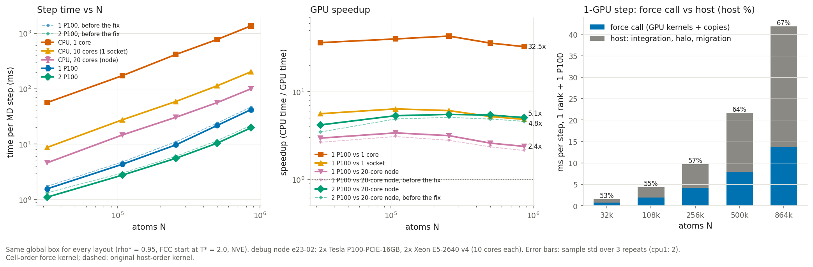

Time per MD step (ms), mean of the repeats:

| N | CPU 1 core | CPU 10 cores | CPU 20 cores | 1 P100 | 2 P100 | 1 P100 vs 1 core | 1 P100 vs node | 2 P100 vs node |
|---|---|---|---|---|---|---|---|---|
| 32,000 | 56.32 | 8.73 | 4.61 | 1.56 | 1.11 | 36.0x | 2.9x | 4.2x |
| 108,000 | 171.98 | 27.49 | 14.65 | 4.33 | 2.76 | 39.7x | 3.4x | 5.3x |
| 256,000 | 413.85 | 58.70 | 30.43 | 9.67 | 5.54 | 42.8x | 3.1x | 5.5x |
| 500,000 | 772.32 | 112.59 | 56.09 | 21.68 | 10.39 | 35.6x | 2.6x | 5.4x |
| 864,000 | 1358.82 | 201.85 | 99.41 | 41.86 | 19.67 | 32.5x | 2.4x | 5.1x |

- **One P100 is 33 to 43x faster than one core.**
- **The fair comparison is against the whole node: one P100 is only 2.4 to 3.4x faster than all 20
  cores, and both P100 together are 4.2 to 5.5x faster.** Each MPI rank drives one GPU, so the GPU
  build uses 1 or 2 of the 20 cores.
- **The host is the bottleneck.** Only the force computation runs on the GPU, and the rest of the
  step (integration, halo exchange packing, atom migration, all on one core per rank) is 53 to 67% of
  the 1-GPU step and grows faster than the force part: 0.83 of 1.56 ms at 32k atoms, 28.2 of 41.9 ms
  at 864k. The force call itself, including the host-device copies of positions and forces, takes
  16 to 23 ns per atom. This is why the GPU-to-node speedup falls at large N, and it is the obvious
  next optimization (device-resident positions and integration).
- Per-rank numbers (1 core vs 1 GPU) and all repeats are in the CSV; the run-to-run spread is below
  1.2% everywhere.
- These runs stay solid (section 8): the speedups hold for a solid with atoms in lattice order. In
  the liquid the original kernel loses a third of its speed, and the fixed kernel does not
  (section 8, "CPU vs GPU in a solid and in a liquid").

**Before the fix** (job 14362860, original host-order kernel, same script): 1 P100 took 1.74, 4.77,
10.99, 23.92 and 46.65 ms at the five sizes and 2 P100 took 1.33, 3.01, 6.02, 11.55 and 21.69 ms, that is
29 to 38x one core, 2.1 to 3.1x the 20-core node with one P100 and 3.5 to 5.1x with two. The force
call took 21 to 28 ns per atom and the host part was 48 to 60% of the 1-GPU step. The CPU columns
of the two jobs agree to 0.6%. Even in the solid, where the old kernel does not drift, the cell-order
kernel is 8 to 17% faster per step (1 P100: 9 to 12%), because the cell-sorted order fits the cell loop better than the
lattice order.

## 2. Strong scaling

`scripts/perf_scaling.slurm`, job 14364485 with the cell-order force kernel
(`runs/perf/results/scaling_14364485_cellorder.csv`; the original-kernel job 14362861 is in
`scaling_14362861.csv`). GPU path: 1 and 2 P100 at N = 256,000 and 1,048,576
(300 steps). CPU path: 1 to 20 cores at N = 256,000 (100 steps, 2 repeats). Ranks are packed onto
socket 0 first (`--distribution=block:block`), so 8 ranks fill most of one socket and 16 and 20 use
both.

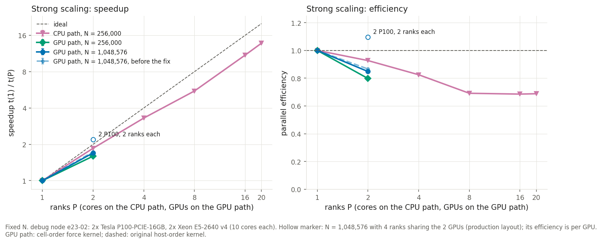

| run | P | step ms | std | speedup | efficiency |
|---|---|---|---|---|---|
| CPU path, N = 256,000 | 1 | 416.86 | 0.29 | 1.00 | 1.00 |
| CPU path, N = 256,000 | 2 | 224.84 | 0.57 | 1.85 | 0.93 |
| CPU path, N = 256,000 | 4 | 126.34 | 0.16 | 3.30 | 0.82 |
| CPU path, N = 256,000 | 8 | 75.37 | 0.53 | 5.53 | 0.69 |
| CPU path, N = 256,000 | 16 | 38.01 | 0.00 | 10.97 | 0.69 |
| CPU path, N = 256,000 | 20 | 30.29 | 0.10 | 13.76 | 0.69 |
| GPU path, N = 256,000 | 1 | 9.69 | 0.09 | 1.00 | 1.00 |
| GPU path, N = 256,000 | 2 | 6.08 | 0.01 | 1.60 | 0.80 |
| GPU path, N = 1,048,576 | 1 | 51.73 | 0.21 | 1.00 | 1.00 |
| GPU path, N = 1,048,576 | 2 | 30.50 | 0.20 | 1.70 | 0.85 |
| GPU path, N = 1,048,576, 4 ranks on 2 P100 | 4 | 23.58 | 0.11 | 2.19 | 0.55 |

The last row has 4 ranks on the same 2 GPUs. The efficiency column divides by ranks (0.55); per
GPU it is 2.19 / 2 = 1.10, above 1 because the host work is spread over 4 cores instead of 2.

- **2 P100 give 1.60x (N = 256k) and 1.70x (N = 1M)**, an efficiency of 0.80 to 0.85. The force call
  halves (16.31 to 8.66 ms at 1M), but the host part (33.4 to 19.5 ms) and the halo exchange
  (2.05 to 2.32 ms) do not scale as well.
- **4 ranks on the same 2 P100 are faster still: 23.58 ms vs 30.50 ms (2.19x over 1 GPU).** Two
  ranks share each GPU, so the host work is spread over 4 cores while the GPUs overlap the two
  ranks' kernels. This is the layout of the production run. It confirms that host work, not the GPU,
  limits the step.
- **CPU path: 13.8x on 20 cores (efficiency 0.69).** The efficiency drops between 4 and 8 ranks and
  then stays flat to 20. MPI communication is below 1 ms per step throughout, so the loss is not
  parallel overhead but per-core slowdown when many cores of one socket are busy, most likely a lower
  turbo clock and shared L3 and memory bandwidth (inferred, not measured). The weak-scaling runs below
  show the same effect directly.

**Before the fix** (job 14362861): 58.52 ms on 1 P100 and 33.78 ms on 2 at N = 1M (1.73x, efficiency
0.87), 25.97 ms with 4 ranks on the 2 P100 (2.25x); at N = 256k 10.87 and 6.55 ms (1.66x). The fix
makes every GPU step 7 to 12% faster but the relative scaling slightly worse, because only the
force call got faster and the host share, which scales worse, grew. The CPU path (no GPU kernel)
agrees with the earlier job to 0.5% (13.67x on 20 cores then).

## 3. Weak scaling

Same jobs. GPU path: 262,144 atoms per P100 (1 and 2 GPUs). CPU path: 32,000 atoms per core
(1 to 20 cores).

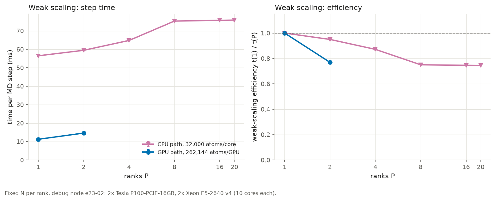

| run | P | N | step ms | std | efficiency |
|---|---|---|---|---|---|
| CPU path, 32,000 atoms/core | 1 | 32,000 | 56.63 | 0.03 | 1.00 |
| CPU path, 32,000 atoms/core | 2 | 64,000 | 59.46 | 0.16 | 0.95 |
| CPU path, 32,000 atoms/core | 4 | 128,000 | 64.73 | 0.18 | 0.87 |
| CPU path, 32,000 atoms/core | 8 | 256,000 | 75.20 | 0.07 | 0.75 |
| CPU path, 32,000 atoms/core | 16 | 512,000 | 76.10 | 0.47 | 0.74 |
| CPU path, 32,000 atoms/core | 20 | 640,000 | 75.88 | 0.26 | 0.75 |
| GPU path, 262,144 atoms/GPU | 1 | 262,144 | 9.96 | 0.08 | 1.00 |
| GPU path, 262,144 atoms/GPU | 2 | 524,288 | 13.61 | 0.08 | 0.73 |

- **CPU path: efficiency 0.95 at 2 cores, 0.75 at 8, and flat at 0.74 to 0.75 to 20 cores.** The
  per-core slowdown seen in strong scaling, with the same atoms per core and MD communication below
  1 ms. Once a socket is busy, adding the second socket costs nothing, which is what weak scaling
  across nodes would look like too.
- **GPU path: 0.73 on 2 P100** (9.96 to 13.61 ms). The force call is unchanged (4.17 to 4.23 ms), and
  the loss is in the host part (5.1 to 7.9 ms) and the halo exchange (0.69 to 1.45 ms).
- **Before the fix** (job 14362861): 11.24 to 14.60 ms, efficiency 0.77, with a force call of 5.4 ms.
  As in strong scaling, the faster kernel makes the host share, and so the loss, relatively larger.

## 4. In situ overhead

`scripts/perf_insitu.slurm` (jobs 14363611 and 14363659) and `scripts/perf_insitu_sep.slurm`
(job 14362880, heterogeneous). All runs use the production layout: N = 1,048,576, 4 SIM ranks
(vproc 2 2 1) sharing the 2 P100, the seeded protocol shortened to 3000 steps (melt 1000, quench
500, hold 1500), no movie. Every rank is bound to 2 cores and each ANA rank runs 2 OpenMP threads,
as in the production run. Each configuration ran 3 times, interleaved with the off runs in the same
job, so slow drifts of the node affect all configurations alike. The overhead is the SIM step time
(`TIMING step_ms` of SIM rank 0, which includes every wait) against the mean of the off runs of
the same job.

**With the cell-order kernel** (job 14364486, `runs/perf/results/insitu_14364486_cellorder.csv`,
K = 100, P_ana = 4, ANA ranks on the GPU node, 3 interleaved repeats):

| Configuration | n | SIM ms/step | vs off | t_analysis mean / max (s) | K x step time (s) | SIM stall (s) | SIM halo + pack (ms/step) |
|---|---|---|---|---|---|---|---|
| analysis off | 3 | 18.61 ± 0.19 | | | | | |
| K = 100, P_ana = 4 | 3 | 19.58 ± 0.06 | **+5.2 ± 1.1%** | 0.84 / 0.86 | 1.96 | 0 | 0.075 |

The analysis costs the SIM ranks 0.97 ms per step, the same as with the original kernel (0.99 ms
at K = 100, below), but the step is 26% shorter, so the same cost is a larger fraction: +5.2% instead
of +4.0%. The larger error bar comes from one off run (18.83 ms against 18.52 and 18.48). The
analysis still fits easily: t_analysis is 0.84 s against 1.96 s of MD between analysis steps (ratio
0.43, was 0.31), with zero stall. Everything else in this section (the K and P_ana sweeps and the
separate-node test) was measured with the original kernel; since the absolute cost did not change,
those conclusions carry over, but the percentages would be about 1.35x larger with the faster step.

The rest of this section: original host-order kernel (jobs 14363611, 14363659, 14362880).

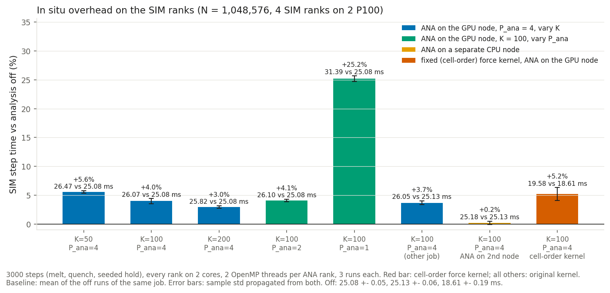

| Configuration | n | SIM ms/step | vs off | t_analysis per analysis step (s), mean / max | SIM stall, total over the run (s) | SIM halo + pack (ms/step) |
|---|---|---|---|---|---|---|
| analysis off (jobs 14363611 + 14363659) | 6 | 25.08 ± 0.05 | | | | |
| K = 50, P_ana = 4 | 3 | 26.47 ± 0.03 | +5.6 ± 0.2% | 0.83 / 1.10 | 0 | 0.143 |
| K = 100, P_ana = 4 | 3 | 26.07 ± 0.10 | +4.0 ± 0.4% | 0.83 / 0.86 | 0 | 0.076 |
| K = 200, P_ana = 4 | 3 | 25.82 ± 0.03 | +3.0 ± 0.2% | 0.83 / 0.85 | 0 | 0.040 |
| K = 100, P_ana = 2 | 3 | 26.10 ± 0.03 | +4.1 ± 0.2% | 1.56 / 1.61 | 0 | 0.077 |
| K = 100, P_ana = 1 | 3 | 31.39 ± 0.11 | **+25.2 ± 0.5%** | 3.08 / 3.15 | **13.6** (max 0.56 per send) | 0.080 |
| analysis off (job 14362880) | 3 | 25.13 ± 0.06 | | | | |
| K = 100, P_ana = 4, ANA on the GPU node | 3 | 26.05 ± 0.06 | +3.7 ± 0.3% | 0.82 / 0.85 | 0 | 0.075 |
| K = 100, P_ana = 4, **ANA on a separate CPU node** | 3 | 25.18 ± 0.05 | **+0.2 ± 0.3%** | 1.00 / 1.03 | 0 | 0.072 |

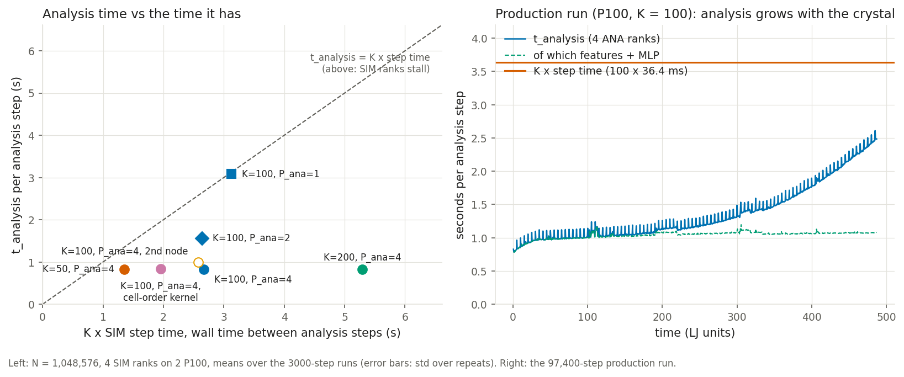

Mean over the 3000-step runs (K x step is the median wall time between analysis steps from the
`t_wall` column):

| K | P_ana | ANA node | K x step time (s) | t_analysis mean (s) | t_analysis max (s) | t_analysis / (K x step) | SIM stall total (s) |
|---|---|---|---|---|---|---|---|
| 50 | 4 | GPU node | 1.36 | 0.83 | 1.10 | 0.61 | 0 |
| 100 | 4 | GPU node | 2.67 | 0.83 | 0.85 | 0.31 | 0 |
| 200 | 4 | GPU node | 5.29 | 0.83 | 0.85 | 0.16 | 0 |
| 100 | 2 | GPU node | 2.65 | 1.56 | 1.61 | 0.59 | 0 |
| 100 | 1 | GPU node | 3.13 | 3.08 | 3.15 | 0.98 | 13.6 |
| 100 | 4 | separate node | 2.58 | 1.00 | 1.03 | 0.39 | 0 |

The ANA ranks on the separate node are 20% slower (1.00 vs 0.83 s), most likely because the Xeon Silver
4116 cores there are slower (2.1 vs 2.4 GHz base), which does not matter while t_analysis stays below
K x step time.

- **With enough ANA ranks the analysis costs the SIM ranks 3 to 6%, and that cost comes from
  sharing the node, not from the in situ protocol.** The work the analysis adds on the SIM side
  (the 2 r_q halo exchange and packing) is 0.04 to 0.14 ms per step (0.2 to 0.6%), and the SIM ranks
  never wait for the ANA ranks (stall 0, maximum 4 µs in the production run). The rest of the 0.7 to
  1.4 ms is the ANA ranks competing with the SIM ranks' host work for the node's cores, caches and
  memory bandwidth. Moving the same 4 ANA ranks to another node removes it: +0.2 ± 0.3%, within
  noise. The repeat of K = 100 in the second job (+3.7%) agrees with the first (+4.0%).
- **The overhead falls with K but not to zero**: 1.39, 0.99 and 0.74 ms per step at K = 50, 100 and
  200, that is at 0.76, 0.38 and 0.19 analysis steps per second. A straight line,
  0.52 ms + 1.16 ms x (analysis steps per second), fits all three to 0.03 ms. The rate-dependent
  part is the work of each analysis step (busy ANA ranks, plus the halo and packing on the SIM side).
  The constant 0.5 ms would remain at any K. It is consistent with idle ANA ranks spinning in
  `MPI_Probe`, which Open MPI does by default (busy polling), but that cause is inferred, not
  measured.
- **P_ana sets whether the analysis keeps up.** t_analysis scales almost inversely with P_ana
  (0.83, 1.56, 3.08 s for 4, 2, 1 ranks). The MD time between analysis steps is K x step = 2.6 s.
  With 2 or 4 ANA ranks the analysis fits (ANA ranks idle 40 to 70% of the time) and the overhead is
  the same, +4%. With 1 ANA rank it does not fit: each SIM rank blocks in `MPI_Wait` on its previous
  message (13.6 s in total), the other SIM ranks wait for it in the halo exchange (MD communication
  rises from 1.7 to 6.1 ms per step), and the step time grows by 25% until K x step equals
  t_analysis (3.13 vs 3.08 s). This is the trade-off of design section 7, measured: P_ana must be large
  enough that t_analysis < K x step time.
- **In the production run the margin shrinks as the crystal grows** (right panel above): the feature
  and MLP time stays at about 1.0 to 1.1 s, but the cluster search and label output on ANA root grow
  with the number of crystalline atoms, from 1.1 s to 2.5 s per analysis step against 3.6 s. Over
  the run t_analysis is close to linear in the crystalline fraction f (about 1.05 + 3.5 f seconds),
  so a longer run with K = 100 and 4 ANA ranks would start to stall at f of about 0.75. Parallelizing
  the cluster search (now on ANA root only) or raising K would fix that.
- The earlier 3 to 9% on/off gap (one off and two on runs in separate jobs, `docs/insitu.md`) is now
  4.0 ± 0.4% at K = 100. With 3 interleaved repeats per configuration the run-to-run spread is 0.03
  to 0.11 ms per step, so the earlier spread (26.43 vs 27.75 ms for two identical on runs) was
  job-to-job variation, which interleaving removes. Its cause was not investigated.

## 5. I/O savings

`analysis/plot_io.py` on the production summary. Both byte counts are logged by the code every
analysis step (`bytes_insitu`, `bytes_fulldump` in the summary). The movie snapshots are exactly
13 N + 40 bytes each, so the label part is the total minus the snapshots.

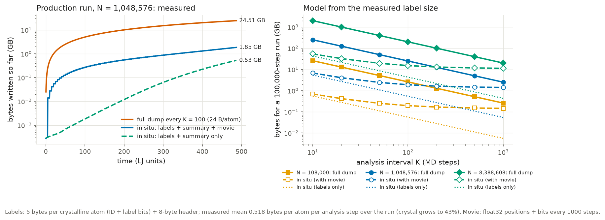

| Production run (N = 1,048,576, K = 100, 974 analysis steps) | Bytes | vs full dump |
|---|---|---|
| Full-precision dump of all atoms every K steps (24 B/atom) | 24.51 GB | 1x |
| In situ total: labels + summary + 97 movie snapshots | 1.85 GB | 13.2x smaller |
| In situ labels + summary only | 0.53 GB | 46.4x smaller |
| of which movie snapshots (every 1000 steps, float32) | 1.32 GB | |

The label file costs 0.518 bytes per atom per analysis step on average over this run (5 bytes per
crystalline atom; the crystal grows to 41% (MLP) or 43% (q̄6) of the box), against 24 bytes for the dump. The right
panel extrapolates to a 100,000-step run with the measured label size:

| N | K | Full dump | In situ, with movie | In situ, labels only |
|---|---|---|---|---|
| 108,000 | 50 / 100 / 200 | 5.2 / 2.6 / 1.3 GB | 0.25 / 0.20 / 0.17 GB | 0.11 / 0.06 / 0.03 GB |
| 1,048,576 | 50 / 100 / 200 | 50.3 / 25.2 / 12.6 GB | 2.45 / 1.91 / 1.63 GB | 1.09 / 0.54 / 0.27 GB |
| 8,388,608 | 50 / 100 / 200 | 403 / 201 / 101 GB | 19.6 / 15.3 / 13.1 GB | 8.7 / 4.3 / 2.2 GB |

- **Both costs are linear in N, so the saving ratio does not depend on N.** It is set by the bytes
  per atom: 24 for the dump against about 0.5 for the labels, a factor of about 46. Only the
  crystalline fraction changes it (for a box that is entirely crystal the labels approach 5 bytes per
  atom, still 5x smaller).
- **K moves both lines together**, except for the movie, which is written every 1000 steps
  regardless of K. The dump grows as 1/K and the in situ output much more slowly, so the saving is
  largest when analysis is frequent: for N = 1M with the movie, 20x at K = 50, 13x at K = 100 and
  only 1.8x at K = 1000, where the movie dominates. Without the movie the ratio is 46x at any K.
- These are bytes, not time. At 1M atoms a dump step would be 25 MB, which takes well under 0.1 s at
  file-system speeds of 0.25 to 1 GB/s, small next to the 2.6 to 3.7 s between analysis steps here.
  The saving matters for storage (24.5 GB for this one run) and grows in absolute terms with N and
  with smaller K.

## 6. Science: n_max(t) and crystalline fraction

The A100 production job (14357822, 4 A100 over 2 nodes, full 150,000-step hold) was still pending
in the `gpu` queue at the end of this work (reason: Priority), so the main n_max(t) result is the P100
run of T3.1: N = 1,048,576, 4 SIM ranks on the 2 P100 of e23-02, 4 ANA ranks, K = 100, stopped by the
1 h debug limit at step 97,400 (hold step 90,400). Summary: `runs/production/results/p100/`.

`python analysis/plot_science.py runs/production/results/p100/prod_summary.dat runs/production/results/p100/prod_p100.in docs/img/nmax_p100.png "P100 run"`

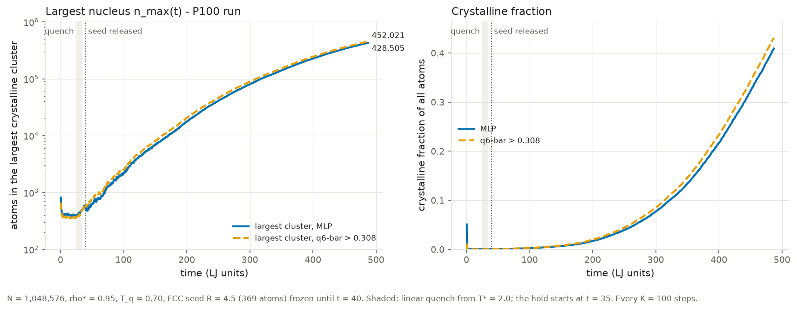

| t | n_max, MLP | n_max, q̄6 > 0.308 | threshold / MLP | crystalline fraction, MLP | crystalline fraction, q̄6 |
|---|---|---|---|---|---|
| 40 (seed release) | 594 | 606 | 1.02 | 0.09% | 0.09% |
| 100 | 2,157 | 2,529 | 1.17 | 0.25% | 0.28% |
| 200 | 17,642 | 20,522 | 1.16 | 1.7% | 2.0% |
| 300 | 80,322 | 88,787 | 1.11 | 7.7% | 8.5% |
| 400 | 227,444 | 244,689 | 1.08 | 21.7% | 23.4% |
| 487 (last) | 428,505 | 452,021 | 1.05 | 40.9% | 43.1% |

- **The seed grows steadily after release and is still growing at the end**, from about 600 atoms
  to 0.43 million (41% of the box). On the log scale growth slows down: the cube root of n_max
  (a radius) grows almost linearly after t of about 200, by 17 to 18 per 100 time units, so the
  interface moves at a roughly constant speed and n_max grows like t^3, not exponentially. No other
  nucleus forms: the second-largest cluster never exceeds
  34 (MLP) or 43 atoms (threshold), see `docs/insitu.md`.
- **The two label sets agree on the shape of the curve; the threshold always finds a larger cluster**
  (5 to 23% more atoms from t = 100 on, up to 30% just after the seed release). The relative gap shrinks as the crystal grows because the surplus sits on the
  surface and at internal defects (see the slab movie), and the surface-to-volume ratio falls.
- The first point (t = 0.5, n_max of 819 and 5% crystalline) is the initial FCC lattice before it
  melts, not nucleation.

## 7. Movie and stills

`viz/extract_frames.py` reduces the 97 in situ movie snapshots of the P100 production run (steps 1000
to 97000, 13.6 MB each, 1.32 GB on CARC) to the crystalline atoms plus a slab through the seed
(193 MB), and `viz/render_movie.py` renders them headless with OVITO 3.17 (Python module, OpenGL
renderer for the movies, Tachyon for the stills). Both views use the same frames; each frame is held
for 3 video frames at 24 fps (12 s).

| File | What it shows | Size |
|---|---|---|
| `docs/media/nucleation_crystal.mp4` | Option A: crystalline atoms only (MLP label), colored by distance from the seed center (viridis, 0 to 55 σ), atoms outside the largest cluster in grey, box outline, camera turning about z | 2.9 MB |
| `docs/media/nucleation_slab.mp4` | Option B: slab \|z - L/2\| < 1.5 through the seed, all atoms, top view, colored by the two label sets (both crystalline, MLP only, q̄6 threshold only, liquid) | 14.8 MB |
| `docs/media/nucleation_crystal.gif` | Option A at 640 px, 12 fps, for the README | 2.4 MB |
| `docs/media/crystal_t150.png`, `crystal_t300.png`, `crystal_t485.png` | Option A stills at t = 150, 300, 485 (1920x1080, Tachyon) | |
| `docs/media/slab_t300.png` | Option B still at t = 300 | |

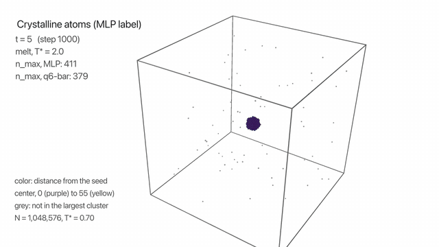

| t = 150 | t = 300 | t = 485 |
|---|---|---|
| 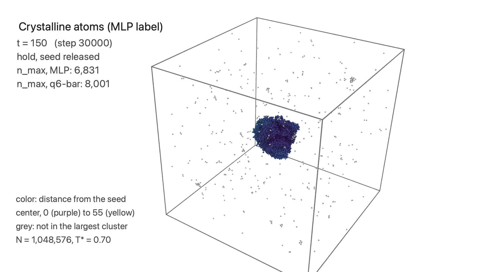 | 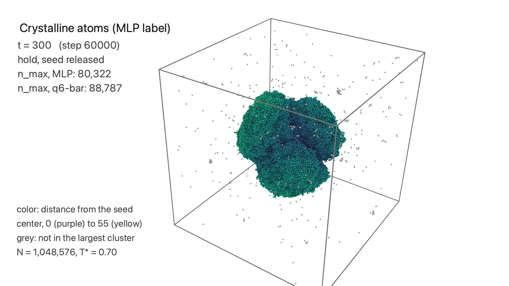 | 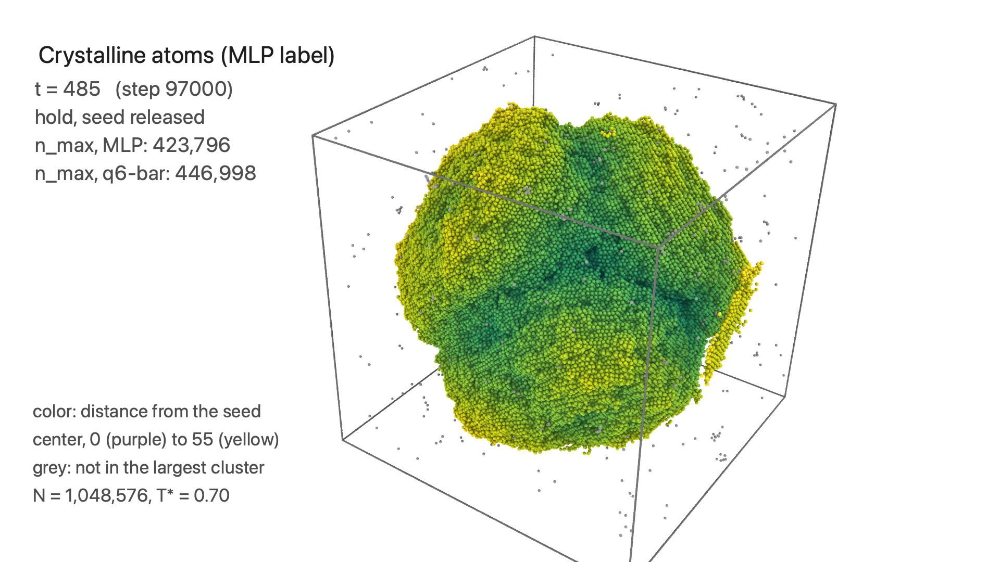 |

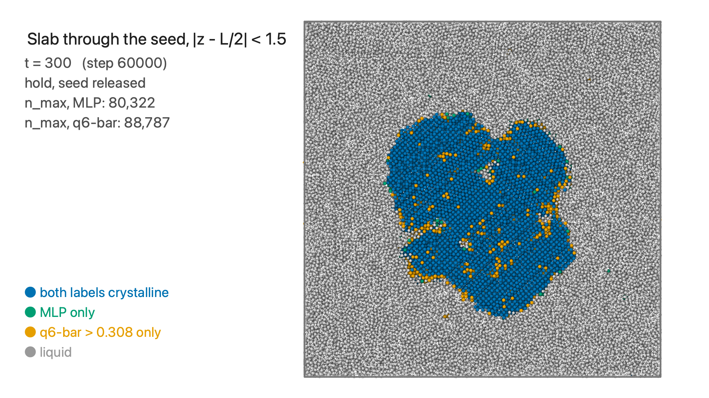

- The crystal grows as a faceted, lobed solid rather than a sphere, and by t = 485 it reaches its own
  periodic images across the box faces (the yellow sheets at the box edge in the last still).
- In the slab, the q̄6-threshold-only atoms (orange) sit on the crystal surface and inside the
  crystal at defects and grain boundaries between lobes, while MLP-only atoms (green) are rare. This
  is the surplus of the threshold n_max seen in the n_max(t) plot.
- The grey specks in view A are single atoms or small groups that the MLP calls crystalline away from
  the seed: transient fluctuations, which the cluster search correctly leaves out of n_max.

## 8. Step time drift and the force kernel fix

The P100 production run averaged 36.4 ms per step, against 26 to 28 ms in the 4000-step smoke tests
of the same layout. `scripts/perf_drift.slurm` (job 14363163) repeats the first 15,000 steps of the
production protocol with a `WALL` line (cumulative wall, force and MD communication time) every
500 steps.

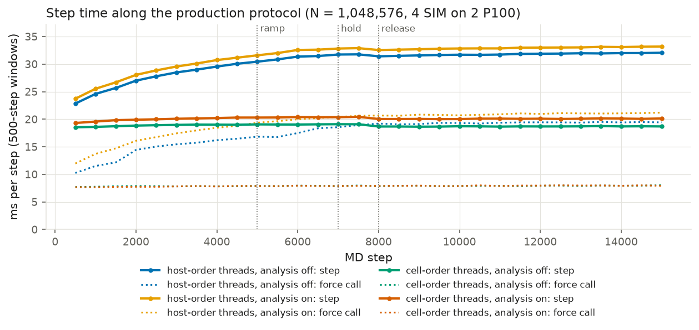

| Kernel | Analysis | melt (steps 0 to 5000) | ramp (5000 to 7000) | hold (7000 to 15000) | force call, melt / hold |
|---|---|---|---|---|---|
| host-order threads (all runs above) | off | 27.5 ms | 31.4 ms | 31.8 ms | 14.4 / 19.3 ms |
| host-order threads | on (K = 100, P_ana = 4) | 28.6 ms | 32.5 ms | 32.9 ms | 16.5 / 20.9 ms |
| cell-order threads (new) | off | 18.9 ms | 19.1 ms | 18.7 ms | 7.8 / 7.9 ms |
| cell-order threads (new) | on (K = 100, P_ana = 4) | 20.0 ms | 20.4 ms | 20.1 ms | 7.8 / 7.9 ms |

- **Cause.** With the original kernel the step time rises from 22.8 to 32 ms over the first ~7000
  steps and then stays flat, and all of the rise is in the GPU force call (10.3 to 19.4 ms per rank);
  host work and MPI communication do not change. The kernel ran one thread per resident atom in host
  array order. At the start the array is in FCC lattice order, so the 32 threads of a warp handle
  neighboring atoms and read the same few cells. During the melt at T* = 2 the atoms diffuse, the
  array order stops matching space, and each thread of a warp walks different cells: poor cache use
  and divergent loop lengths. Once the order is fully scrambled the cost stops growing. The smoke
  tests (4000 steps, 1000 of them melt) never reached the plateau, which explains most of the gap.
- **Fix** (`src/force_cuda.cu`, commit 9d1a074): thread s handles atom `vals[s]` of the cell sort
  that the kernel already does, so a warp works on one region of space whatever the host order is.
  Each atom still sums over the same cells in the same order, so the forces do not change by a bit:
  `scripts/perf_sortfix.slurm` (job 14363770) runs the old and new binary on the same seeded input
  and the energies agree to all printed digits over 3000 steps. The force call is now 7.8 to 7.9 ms
  from start to end, and the step time on the production protocol drops from 31.8 to 18.7 ms in the
  hold (1.7x), with no drift.
- The remaining 4 to 5 ms between the drift plateau (32 to 33 ms) and the production average (about
  37 ms in the hold) was not reproduced in these 15,000-step runs. Candidates are the analysis load
  that grows with the crystal (t_analysis 1.1 to 2.5 s on cores shared with the SIM ranks) and the
  movie snapshots (every 1000 steps, not used in these runs). Not measured.
- **Sections 1 to 4 were first measured with the original kernel**, and the speedup, the one-node
  scaling and the K = 100, P_ana = 4 in situ overhead were then rerun with the cell-order kernel
  (jobs 14364484, 14364485, 14364486; the `_cellorder` files). Sections 1 to 4 now report the new
  numbers and keep the old ones in "before the fix" notes. The original-kernel speedup and scaling
  runs are NVE runs that stay solid, and in a solid there is no drift (next subsection), so they are
  steady-state numbers for a solid. The original-kernel in situ runs (3000 steps of the melt
  protocol) are all at the same point of the drift, so their on/off differences are fair, but their
  absolute step times (25 ms) are below the hold-phase plateau (32 ms).

### CPU vs GPU in a solid and in a liquid

The plain-MD inputs of sections 1 to 3 start from the FCC lattice at InitTemp 2.0 without a
thermostat. At ρ* = 0.95 that relaxes to T of about 1 and stays a hot solid, so the atoms keep
their lattice (memory) order for the whole run, which is the best case for both paths.
`scripts/perf_mixed.slurm` runs the 20-core CPU path and both kernels on 1 and 2 P100 for longer:
NVE from the lattice (job 14364184; N = 256,000 for 3000 steps and 864,000 for 2000 steps), and with
the thermostat holding T* = 2 so the box melts (`MELT=1`, job 14364316; N = 256,000 for 6000 steps).

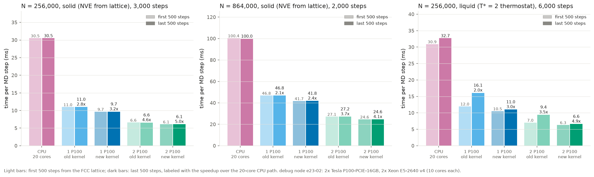

Last 500 steps, ms per step (speedup over the 20-core CPU path):

| State, N | CPU, 20 cores | 1 P100, old kernel | 1 P100, new kernel | 2 P100, old kernel | 2 P100, new kernel |
|---|---|---|---|---|---|
| solid, 256,000 | 30.53 | 11.01 (2.8x) | 9.67 (3.2x) | 6.58 (4.6x) | 6.10 (5.0x) |
| solid, 864,000 | 99.96 | 46.80 (2.1x) | 41.81 (2.4x) | 27.21 (3.7x) | 24.59 (4.1x) |
| liquid, 256,000 | 32.72 | 16.07 (2.0x) | 11.03 (3.0x) | 9.43 (3.5x) | 6.62 (4.9x) |

- **In the solid nothing drifts** (first and last 500 steps agree within 0.5%), which confirms that
  the section 1 to 3 numbers are steady-state numbers for a solid.
- **In the liquid the CPU path slows by 7%** (30.9 to 32.7 ms, the linked-cell loop also loses
  locality) **and the old GPU kernel by 34%** from the first to the last 500 steps on 1 and on 2 P100
  (46% above the solid on 1 P100; force call 5.8 to 9.5 ms). With the new kernel the force call stays
  at 4.4 to 4.5 ms.
- **The fair answer for the production regime (a liquid, N = 256,000): one P100 is 2.0x the 20-core
  node with the original kernel and 3.0x with the fixed one, and 2 P100 are 3.5x and 4.9x.** The new
  kernel is also 7 to 12% faster per step in the solid (force call 24 to 26% faster), where the atoms
  are ordered, because the cell-sorted order fits the cell loop better than the lattice order.

## Anomalies and open items

- **GPU availability.** No `gpu`-partition node could be scheduled during the measurements, so all
  GPU numbers come from one debug node with 2 P100 and GPU scaling stops at 2 GPUs. The multi-node
  V100 job (14362902, 1 to 8 GPUs, strong and weak) and the A100 production job (14357822) were still
  pending (Priority) at the end. To finish them later:
  `scp carc:insitu-perf/runs/perf/results/scaling_multi_*.csv runs/perf/results/` and rerun
  `analysis/plot_perf.py`, which adds the multi-node series. For the A100 run:
  `analysis/plot_science.py runs/production/out/prod_summary.dat runs/production/prod.in docs/img/nmax_a100.png "A100 run" --second runs/production/results/p100/prod_summary.dat "P100 run"`.
- **Step-time drift of the force kernel** (section 8): found, explained and fixed. The fix landed
  after the first measurements; the speedup, one-node scaling and K = 100 in situ overhead were
  rerun with it, while the K and P_ana sweeps, the separate-node test and the production run use the
  original kernel. The multi-node job and the A100 production job also use binaries built before the
  fix.
- **The NVE speedup and scaling runs stay solid** (FCC at InitTemp 2.0 relaxes to T of about 1 at
  ρ* = 0.95), so they measure both paths with atoms in lattice order. The thermostatted melt runs in
  section 8 give the numbers for a liquid.
- **A hang that looked like an MPI startup problem was a bug in the job inputs.** The analysis-off
  runs of `perf_insitu.slurm` wrote `InsituInterval 0`, and `insitu_nsteps()` looped forever on it
  while the other ranks waited in `MPI_Comm_split_type` (found with gdb on the hung ranks). Fixed in
  the code (commit 0aca834) and the inputs. Three job slots were lost to it, no data was affected.
- **Residual production slowdown.** The production run's hold (about 37 ms per step) is 4 to 5 ms
  slower than the 15,000-step drift plateau of the same layout (32 to 33 ms). Not reproduced or
  explained (candidates: growing analysis load on the shared cores, movie snapshots).
- **Per-rank force times are noisy when 2 ranks share a GPU** (11.5 to 14.4 ms between identical
  runs): the force call of one rank includes waiting for the other rank's kernels. The step times
  are stable (std 0.03 to 0.11 ms), and all conclusions use step times.
- **Two causes in this report are inferred rather than measured:** the per-core slowdown of the CPU
  path at 8 or more busy cores (turbo clock or shared cache and memory bandwidth), and the
  constant 0.5 ms in situ cost (ANA ranks busy-polling in `MPI_Probe`). Setting
  `OMPI_MCA_mpi_yield_when_idle=1` for the second, and pinning the clock for the first, would test them.
- **The top size of the speedup sweep is 864,000, not 1,048,576**: the same global box must divide
  into 20 CPU subdomains (vproc 5 2 2), and 2^20 atoms do not. The strong scaling uses N = 1,048,576.
- **I/O is reported in bytes, not seconds**; the code does not time file writes separately.
- **The movie covers the P100 run up to step 97,000** (t = 485, crystal at 41% of the box), the
  last movie snapshot before the run hit its time limit.
